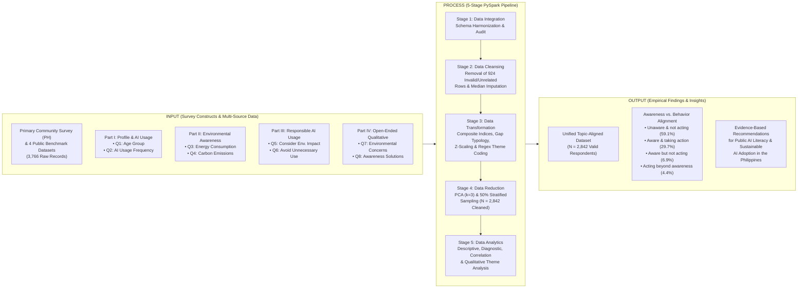

# CHAPTER I: INTRODUCTION

**Study Title:** *AI and the Environment: An Analysis of Public Awareness*  
**Course:** IT 119 – Data Scalability and Analytics (BSIT 3B)  
**Researchers:** Renz Dominic Azul, Gabriel de la Cruz, Godwin Reigh Galvez  

---

## 1.1 Background of the Study

Artificial Intelligence (AI) has rapidly transitioned from a specialized computing technology into an essential tool in everyday life, transforming education, communication, software development, business operations, and public services. However, the rapid expansion of generative and large-scale AI models carries a substantial and often overlooked environmental footprint. Training and deploying modern AI systems require hyperscale data centers that consume vast quantities of electricity, water for liquid and evaporative cooling, and specialized hardware that contributes to electronic waste and lifecycle carbon emissions. According to the International Energy Agency (IEA, 2025), global data centers consumed approximately 415 terawatt-hours (TWh) of electricity in 2024—equivalent to roughly 1.5% of total global electricity demand—and this consumption is projected to more than double by 2030, driven primarily by the widespread adoption of AI workloads.

Despite the rapid growth of AI usage, empirical studies indicate that public awareness of AI's environmental costs remains uneven across regions and user groups. Cho et al. (2025) found significant disparities in public awareness across East Asia, reporting that only 21.9% of surveyed respondents in Japan and 50.1% in South Korea were aware of AI's environmental impacts, including electricity consumption, cooling water demand, and carbon emissions. Similarly, Jelonek and Pawełoszek (2026) demonstrated through a multidimensional Environmental Awareness Index that while users increasingly rely on digital and AI tools in their daily routines, cognitive awareness of AI's ecological footprint does not automatically translate into sustainable digital habits without deliberate education and behavioral self-regulation.

This issue is particularly timely and relevant in the Philippines as the country positions itself as a regional hub for AI and semiconductor infrastructure. In April 2026, the Philippines joined *Pax Silica*, a United States-led initiative aimed at strengthening resilient supply chains for semiconductors and artificial intelligence (Rocamora, 2026). As part of this initiative, plans were unveiled for a 4,000-acre industrial zone within the Luzon Economic Corridor designed to operate as an AI-native industrial acceleration hub supporting high-tech operations (Villanueva, 2026). While these developments promise economic investment, technological advancement, and employment opportunities, they also underscore the urgent need for Filipinos and everyday AI users to understand the environmental implications of expanding AI infrastructure and adoption.

In the context of Data Scalability and Analytics, evaluating public awareness and responsible AI usage requires integrating primary local survey data with broader international benchmark datasets to uncover statistically robust patterns across thousands of users. Therefore, this study—**"AI and the Environment: An Analysis of Public Awareness"**—investigates the level of awareness regarding the environmental impacts of AI and its relationship with responsible AI usage across a unified multi-source dataset (`N = 2,842` cleaned records from `3,766` raw survey responses, anchored on the primary Philippine community survey). Using a five-stage Apache PySpark data processing and analytics pipeline, the study provides empirical evidence on how public awareness relates to eco-conscious AI behavior and what interventions can bridge the awareness-to-behavior gap.

---

## 1.2 Statement of the Problem

While Artificial Intelligence tools are increasingly used several times a day for academic, professional, and personal tasks, the environmental costs of each query and model run remain largely invisible to ordinary users. Consequently, many users adopt AI tools intensively without considering electricity consumption, data-center carbon emissions, or cooling water depletion, and without practicing responsible restraint when tasks can be completed without AI.

Specifically, this study seeks to answer the following research questions:

1. **What is the demographic profile and AI usage frequency of the respondents** in terms of:
   1.1. Age group (`Q1`); and  
   1.2. Frequency of using Artificial Intelligence tools (`Q2`)?
2. **What is the level of awareness of the respondents regarding the environmental impacts of Artificial Intelligence** in terms of:
   2.1. Awareness that using AI systems consumes significant amounts of electricity or energy (`Q3`);  
   2.2. Awareness that AI data centers contribute to carbon emissions and other environmental impacts (`Q4`); and  
   2.3. Overall composite `Awareness_Index`?
3. **What is the level of responsible AI usage among the respondents** in terms of:
   3.1. Considering the environmental impact of AI when deciding how to use AI tools (`Q5`);  
   3.2. Avoiding unnecessary use of AI when a task can be completed without it (`Q6`); and  
   3.3. Overall composite `Behavior_Index`?
4. **Is there a significant relationship and alignment (or gap) between the respondents' AI usage frequency, environmental awareness (`Awareness_Index`), and responsible AI usage (`Behavior_Index`)?**
5. **What specific environmental concerns (`Q7`) and suggested solutions for increasing public awareness and encouraging responsible AI use (`Q8`) emerge from the respondents' open-ended qualitative responses?**

---

## 1.3 Objectives of the Study

### General Objective
To assess the level of public awareness regarding the environmental impact of Artificial Intelligence and determine its relationship with responsible AI usage through descriptive, diagnostic, and exploratory big-data analytics using Apache PySpark.

### Specific Objectives
1. **To determine the AI usage frequency** and age distribution of respondents across the primary community survey and integrated public datasets (`Q1`–`Q2`).
2. **To determine the level of awareness** of respondents regarding the environmental impacts of Artificial Intelligence, specifically electricity consumption and data-center carbon emissions (`Q3`–`Q4`, `Awareness_Index`).
3. **To assess the level of responsible AI usage** among respondents, specifically their consideration of environmental impacts and willingness to avoid unnecessary AI use (`Q5`–`Q6`, `Behavior_Index`).
4. **To examine the relationship and alignment between environmental awareness and responsible AI behavior** (`Awareness_Behavior_Gap` and `gap_type`) across different AI-usage segments (`Light`, `Moderate`, and `Heavy` users).
5. **To explore the primary environmental concerns and actionable suggestions** of respondents regarding the sustainable and responsible use of Artificial Intelligence (`Q7`–`Q8`).

---

## 1.4 Conceptual Framework

This study is anchored on an **Input–Process–Output (IPO)** and **Independent–Dependent Variable** framework linking **Respondent Profile & AI Usage Frequency** and **Environmental Awareness of AI** to **Responsible AI Usage Behavior** and **Qualitative Sustainability Insights**.

### Narrative Explanation of the Framework
1. **Input**: The study takes as input the primary Philippine community survey (`main_dataset.csv`, `Q1`–`Q8`) alongside four public generative-AI survey datasets (`3,766` total raw records). The survey instrument captures four core dimensions: Respondent Profile and AI Usage Frequency (`Q1`–`Q2`), Environmental Awareness (`Q3`–`Q4`), Responsible AI Usage (`Q5`–`Q6`), and Open-Ended Qualitative Concerns and Solutions (`Q7`–`Q8`).
2. **Process**: Through a scalable 5-stage Apache PySpark pipeline, the raw multi-source records undergo schema integration (**Stage 1**), strict topic-aligned cleansing that removes `924` duplicate, straight-line, failed-attention-check, incomplete, or off-topic records to retain `2,842` valid records (**Stage 2**), composite feature engineering (`Awareness_Index`, `Behavior_Index`, `Awareness_Behavior_Gap`, `gap_type`, and 12 NLP regex themes for `Q7` and `Q8`) (**Stage 3**), dimensionality and numerosity reduction via `PCA(k=3)` and 50% stratified sampling (**Stage 4**), and descriptive, diagnostic, and exploratory statistical analysis (**Stage 5**).
3. **Output**: The pipeline yields quantified empirical insights on the relationship between awareness and responsible behavior (`r = +0.7728`), a four-part behavioral alignment typology (`Unaware & not acting`, `Aware & taking action`, `Aware but not acting`, and `Acting beyond awareness`), prioritized qualitative themes (led by water scarcity, energy consumption, education/training, and mindful usage), and actionable policy and educational recommendations.

---

## 1.5 Significance of the Study

As Artificial Intelligence becomes deeply embedded in daily academic, professional, and personal workflows, understanding its environmental externalities is critical for sustainable digital transformation. The findings of this study will directly benefit the following stakeholders:

- **Everyday AI Users and the General Community**: By highlighting the hidden electricity, water, and carbon costs of routine AI prompts, this study empowers citizens and students to adopt mindful, responsible AI habits—such as avoiding unnecessary queries when tasks can be completed without AI.
- **Educational Institutions and Educators**: Since *"Education & training"* (`38.4%`) emerged as the top solution in the qualitative analysis, universities and schools can use these findings to integrate sustainable and responsible AI literacy into Information Technology and general education curricula.
- **Policymakers and Philippine Government Agencies**: As the Philippines develops AI-native industrial infrastructure such as the *Pax Silica* hub in the Luzon Economic Corridor, empirical baseline data on public environmental awareness can guide environmental impact transparency, green data-center standards, and public awareness campaigns.
- **AI Developers and Technology Providers**: The findings support calls for eco-transparency—such as displaying estimated energy or carbon usage per query and optimizing smaller, energy-efficient models for routine tasks.
- **Future Researchers in Data Scalability and Sustainable AI**: Because literature on the environmental awareness of AI remains scarce (Cho et al., 2025; Jelonek & Pawełoszek, 2026), this study provides both a reproducible 5-stage PySpark big-data integration methodology and an empirical benchmark dataset (`N = 2,842`) for future sustainability research.

---

## 1.6 Scope and Delimitations

- **Scope**:
  - **Thematic Focus**: The study focuses strictly on public awareness of the environmental impacts of Artificial Intelligence (energy consumption, carbon emissions, water usage, e-waste, heat/noise, and ecosystem effects) and responsible AI usage behaviors (considering environmental impact and avoiding unnecessary AI usage).
  - **Dataset and Sample Size**: The study is anchored on a primary Philippine community survey (`84` raw responses, `72` topic-valid cleaned responses) integrated with four publicly available generative-AI survey datasets from Mendeley Data and Zenodo—Arifen et al. (2026) (`2,613` raw, `2,087` cleaned), Lee & Legowo (2026) (`400` raw, `399` cleaned), and Hands et al. (2026) UK higher-education students (`519` raw, `262` cleaned) and staff (`150` raw, `22` cleaned)—forming a unified dataset of `3,766` raw records and `2,842` cleaned, topic-valid records.
  - **Analytical Methodology**: Data processing is implemented in Python using Apache PySpark (`pyspark==4.2.0`) across five sequential stages: Data Integration, Data Cleansing, Data Transformation, Data Reduction (`PCA(k=3)` and 50% stratified sampling), and Descriptive, Diagnostic, and Exploratory Analytics.

- **Delimitations**:
  - **Exclusion of Unrelated Constructs**: Survey variables and rows in the primary or public datasets that pertain solely to academic cheating/plagiarism checklists, staff grading rubrics, or non-environmental topics (such as hacking, cybersecurity, data privacy, or speculative science-fiction AGI sentience) were deliberately excluded (`924` rows removed during Stage 1–2 audit) to preserve strict alignment with the research topic.
  - **Self-Reported Survey Measures**: Awareness and behavioral scores (`Q2`–`Q6`) are based on standardized 5-point self-reported Likert scales (`1.0` to `5.0`) rather than direct hardware telemetry of respondents' actual electricity consumption.
  - **Cross-Sectional Design**: The dataset captures respondents' perceptions and habits at a single point in time and establishes statistical association (`r = +0.7728`) rather than longitudinal causality.

---

## 1.7 Definition of Terms

To ensure clarity and consistency throughout the study, the following key terms are defined conceptually and operationally:

1. **Artificial Intelligence (AI) Usage Frequency (`Q2` / `usage_freq_n`)**:
   - *Conceptual*: The regularity with which an individual interacts with generative or analytical AI tools in daily life.
   - *Operational*: A harmonized 5-point numerical score (`1.0 = Rarely`, `2.0 = Once a week`, `3.0 = Several times a week`, `4.0 = Once a day`, `5.0 = Several times a day`) used to classify respondents into `Light (rarely)`, `Moderate (weekly)`, and `Heavy (daily+)` usage segments.
2. **Environmental Awareness of AI (`Q3`–`Q4` / `Awareness_Index`)**:
   - *Conceptual*: An individual's knowledge and recognition that operating AI systems and hyperscale data centers consumes electricity and water and generates carbon emissions and electronic waste.
   - *Operational*: The composite mean of two 5-point Likert items: `aware_energy_n` (`Q3`: awareness that AI consumes significant electricity/energy) and `aware_carbon_n` (`Q4`: awareness that AI data centers contribute to carbon emissions), computed as $\text{Awareness\_Index} = (\text{Q3} + \text{Q4}) / 2$.
3. **Responsible AI Usage (`Q5`–`Q6` / `Behavior_Index`)**:
   - *Conceptual*: The mindful, self-regulated practice of weighing ecological costs when using AI and refraining from trivial or unnecessary AI queries when tasks can be completed without AI.
   - *Operational*: The composite mean of two 5-point Likert items: `consider_impact_n` (`Q5`: considering environmental impact when deciding how to use AI) and `avoid_use_n` (`Q6`: avoiding unnecessary use of AI when the task can be completed without it), computed as $\text{Behavior\_Index} = (\text{Q5} + \text{Q6}) / 2$.
4. **Awareness–Behavior Gap (`Awareness_Behavior_Gap` & `gap_type`)**:
   - *Conceptual*: The discrepancy between what an individual knows about environmental harm and how they actually behave when using technology.
   - *Operational*: The numerical difference $\text{Awareness\_Behavior\_Gap} = \text{Awareness\_Index} - \text{Behavior\_Index}$, categorized into four distinct behavioral alignment profiles:
     - **Unaware & not acting**: `|Gap| < 1.0` and `Awareness_Index < 3.0` (`59.1%` of respondents).
     - **Aware & taking action**: `|Gap| < 1.0` and `Awareness_Index >= 3.0` (`29.7%` of respondents).
     - **Aware but not acting**: `Gap >= +1.0`, indicating high awareness without corresponding behavioral restraint (`6.9%` of respondents).
     - **Acting beyond awareness**: `Gap <= -1.0`, indicating restrained/mindful AI usage despite lower technical awareness (`4.4%` of respondents).
5. **Environmental Impact Concerns (`Q7` / `concern_text`)**:
   - *Conceptual*: Specific ecological risks associated with AI infrastructure perceived by the public.
   - *Operational*: Open-ended responses coded via PySpark regular-expression (`rlike`) text mining into six environmental themes: `c_water` (water use/scarcity), `c_energy` (electricity/power drain), `c_carbon` (carbon emissions/climate change), `c_ewaste` (electronic waste/hardware), `c_noise_heat` (heat and noise pollution), and `c_ecosystem` (biodiversity/resource depletion).
6. **Public Awareness & Responsible-Use Solutions (`Q8` / `awareness_text`)**:
   - *Conceptual*: Actionable interventions proposed by respondents to improve ecological literacy and sustainable AI adoption.
   - *Operational*: Open-ended responses coded via PySpark `rlike` text mining into six solution themes: `s_education` (education and curriculum integration), `s_campaign` (public/social media campaigns), `s_policy` (government regulation and standards), `s_transparency` (disclosing energy/carbon footprints per query), `s_tech` (renewable energy and greener AI models), and `s_responsible_use` (personal restraint and mindful usage).
7. **Data Scalability Pipeline (5-Stage PySpark Architecture)**:
   - *Operational*: The end-to-end distributed data processing workflow implemented in `dsa_final/code/data-cleaning/` consisting of Stage 1 (`01_data_integration.py`), Stage 2 (`02_data_cleansing.py`), Stage 3 (`03_data_transformation.py`), Stage 4 (`04_data_reduction.py`), and Stage 5 (`05_data_analysis_and_visualization.py`).

