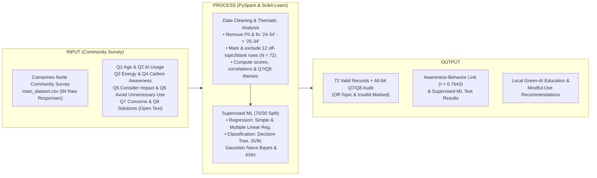

# CHAPTER I: INTRODUCTION

**Study Title:** *AI and the Environment: An Analysis of Public Awareness and Responsible AI Usage*  
**Course:** IT 119 - Data Scalability and Analytics (BSIT 3B)  
**Researchers:** Renz Dominic R. Azul, Gabriel R. de la Cruz, Godwin Reigh M. Galvez  

---

## 1.1 Background of the Study

Students and workers now open AI chatbots the same way they open a calculator. Because a response appears on a laptop or phone screen almost immediately, almost nobody pictures the server racks running behind the scenes. Those data centers house thousands of processors that consume heavy electricity, evaporate clean freshwater for cooling, and generate hardware waste. According to the International Energy Agency (IEA, 2025), global data centers drew roughly 415 terawatt-hours (TWh) of electricity in 2024, nearly 1.5% of global electricity demand, and AI workloads could push that demand to more than double by 2030.

Public understanding has not kept pace with daily adoption. Cho et al. (2025) surveyed residents in Japan and South Korea and found a wide gap: only 21.9% of Japanese respondents and 50.1% of South Korean respondents knew about AI's electricity, water, and carbon costs. Jelonek and Pawełoszek (2026) surveyed 224 respondents using a composite Environmental Awareness Index and reported that more than two-thirds backed greener AI tools once informed. In the Philippines, Dungo et al. (2025) found that while college students recognize AI's electricity demand, most still miss data-center cooling water and rare-earth mineral extraction.

That blind spot became a local issue in April 2026, when the Philippines joined *Pax Silica*, a US-led supply-chain partnership for semiconductors and artificial intelligence that outlines a 4,000-acre industrial hub in the Luzon Economic Corridor, as reported by Rocamora (2026) and Villanueva (2026). Projects at that scale bring investment and jobs, yet they also raise immediate local questions about power grids, municipal water supply, and land conversion.

This study examines community survey data collected from students and residents in Camarines Norte, Philippines (`84` raw responses yielding `72` valid records after auditing and marking `12` excluded entries). Combining Apache PySpark data validation, thematic coding of open-ended `Q7` and `Q8` answers, and supervised machine learning models, the study measures local awareness of AI's ecological costs and evaluates how reliably awareness predicts responsible habits.

---

## 1.2 Statement of the Problem

Everyday AI users rarely see the electricity, cooling water, or carbon attached to a prompt. Five questions guide this study:

1. Who answered the survey (`Q1`), and how often do they use AI tools (`Q2`)?
2. How aware are respondents of AI's electricity consumption (`Q3`), data-center carbon impacts (`Q4`), and overall `Awareness_Index`?
3. How responsibly do they use AI when weighing environmental impact (`Q5`), skipping unnecessary prompts (`Q6`), and scoring on overall `Behavior_Index`?
4. How closely does awareness predict responsible behavior, and how accurately do standard supervised machine learning models predict behavior on `72` records?
5. What worries (`Q7`), practical solutions (`Q8`), and unrelated or invalid entries appear across all `84` raw open-ended responses?

---

## 1.3 Objectives of the Study

Our general objective is to measure community awareness of AI's environmental impact, test how strongly awareness links to responsible AI habits, categorize every open-ended reply (including unrelated ones), and evaluate standard supervised machine learning models on the cleaned survey (`N = 72`).

Specifically, the study aims to:
1. Profile respondents' age brackets and AI usage habits (`Light`, `Moderate`, and `Heavy` users).
2. Measure environmental awareness (`Awareness_Index`) and responsible usage (`Behavior_Index`), then evaluate their correlation and alignment gap.
3. Categorize all `84` raw open-ended answers in `Q7` and `Q8`, marking off-topic and invalid entries transparently.
4. Train and compare six classic supervised machine learning models (Simple Linear Regression, Multiple Linear Regression, Decision Tree, Support Vector Machine, Gaussian Naive Bayes, and K-Nearest Neighbors) using a 70/30 train-test split.

---

## 1.4 Conceptual Framework

We follow an Input-Process-Output (IPO) workflow centered on our Camarines Norte survey dataset (`main_dataset.csv`):

---

## 1.5 Significance of the Study

- Students and Everyday AI Users: Makes the cooling-water and electricity footprint of casual prompts concrete, pointing toward practical habits like skipping AI on tasks you can do yourself.
- Schools and Teachers: Directly supports curricular updates, since *Education & Literacy Programs* (`57.7%`) topped all respondent suggestions in `Q8`.
- Local Leaders: Captures grounded Filipino worries around municipal water shortages (`61.1%`) and land impacts tied to *Pax Silica* (`11.1%`).
- Analytics Students: Demonstrates a practical workflow combining Apache PySpark survey cleaning, qualitative theme coding, and supervised machine learning on community data (`N = 72`).

---

## 1.6 Scope and Delimitations

This study analyzes our Google Forms community survey (`dataset/main_dataset.csv`: `84` raw responses, `72` valid records) collected in Daet and nearby municipalities of Camarines Norte during the Second Semester of AY 2025-2026.

Three boundaries apply to this study. First, `86.1%` of our `72` clean respondents are aged 18-24, so these findings reflect a local youth and student community rather than the whole country. Second, we excluded and documented `12` raw rows from quantitative modeling, consisting of `7` off-topic Q7 answers (about privacy, hacking, misinformation, dependence, fake reality, or sentient AI), `4` blank forms, and `1` dot-only entry, and we excluded `1` copied Q8 prompt from `Q8` counts (`n = 71` valid Q8 replies). Third, Likert ratings measure self-reported awareness and habits rather than metered device wattage.

---

## 1.7 Definition of Terms

1. AI Usage Frequency (`Q2` / `usage_freq_n`): How often a person uses AI tools, scored `1` (*Rarely*) to `5` (*Several times a day*), grouped into *Light* (`1-2`), *Moderate* (`3`), and *Heavy* (`4-5`).
2. Awareness Index: Average of `Q3` (electricity awareness) and `Q4` (carbon/data-center awareness) on a `1.0` to `5.0` scale.
3. Behavior Index: Average of `Q5` (weighing environmental impact during use) and `Q6` (skipping unnecessary AI use) on a `1.0` to `5.0` scale.
4. Awareness-Behavior Gap: `Awareness_Index - Behavior_Index`, sorting respondents into *Aware & taking action* (`69.4%`), *Aware but not acting* (`12.5%`), *Acting beyond awareness* (`9.7%`), and *Unaware & not acting* (`8.3%`).
5. Unrelated / Off-Topic Response: Any `Q7` reply discussing non-environmental AI risks like hacking, privacy, misinformation, or autonomous robots (`n = 7` of `84` raw forms).
6. Train-Test Split (`70/30`): Dividing the `72` clean survey records into `50` training records (`70%`) used to fit supervised models and `22` held-out testing records (`30%`) used to check out-of-sample prediction accuracy.
