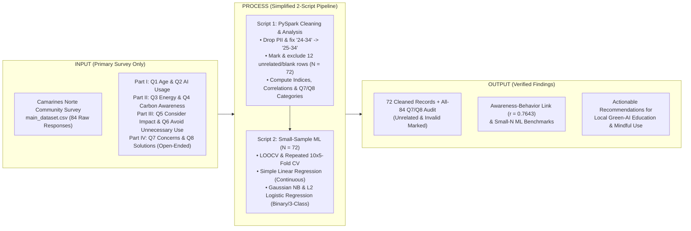

# CHAPTER I: INTRODUCTION

**Study Title:** *AI and the Environment: An Analysis of Public Awareness and Responsible AI Usage*  
**Course:** IT 119 – Data Scalability and Analytics (BSIT 3B)  
**Researchers:** Renz Dominic R. Azul, Gabriel R. de la Cruz, Godwin Reigh M. Galvez  

---

## 1.1 Background of the Study

Artificial Intelligence (AI) tools—including conversational chatbots, writing assistants, and code generators—have rapidly transitioned into everyday tools across education, communication, software development, and daily routines. Behind their seamless screen interfaces, however, AI workloads rely on hyperscale data centers that demand large quantities of electricity, freshwater for evaporative and liquid cooling, and specialized silicon hardware that generates lifecycle carbon emissions and electronic waste. According to the International Energy Agency (IEA, 2025), global data centers consumed approximately 415 terawatt-hours (TWh) of electricity in 2024—about 1.5% of total global electricity demand—and this consumption is projected to more than double by 2030, driven primarily by AI workloads.

Empirical studies indicate that public awareness of AI's environmental costs remains uneven. Cho et al. (2025) reported that only 21.9% of respondents in Japan and 50.1% in South Korea were aware of AI's electricity, water, and carbon footprints. Jelonek and Pawełoszek (2026) developed a multidimensional Environmental Awareness Index ($N = 224$) and found that although more than two-thirds supported greener AI, cognitive awareness and daily habits require active educational support. In the Philippines, Dungo et al. (2025) found that while college students recognize AI's electrical demand, many overlook freshwater cooling withdrawals and resource extraction.

This issue is especially timely in the Philippines. In April 2026, the country joined *Pax Silica*, a United States-led initiative to strengthen global semiconductor and AI supply chains, including plans for a 4,000-acre AI-native industrial acceleration hub in the Luzon Economic Corridor (Rocamora, 2026; Villanueva, 2026). While such infrastructure promises investment and employment, it also heightens local public concern regarding water security, electricity grids, land conversion, and community livelihoods.

Accordingly, this study—**"AI and the Environment: An Analysis of Public Awareness and Responsible AI Usage"**—focuses exclusively on our primary community survey collected in Camarines Norte, Philippines (`84` raw responses $\to$ `72` cleaned, topic-valid records after explicitly auditing and removing `12` unrelated or blank entries). Using a simple, transparent Apache PySpark cleaning and analytics workflow paired with small-sample cross-validated machine learning, the study quantifies the relationship between environmental awareness and responsible AI use and deeply categorizes open-ended public concerns (`Q7`) and suggested solutions (`Q8`).

---

## 1.2 Statement of the Problem

While AI tools are increasingly used daily for academic and personal tasks, their electricity, water, and carbon costs remain largely invisible to everyday users. Specifically, this study seeks to answer five research questions:

1. **What is the demographic profile and AI usage frequency of the respondents** in terms of age group (`Q1`) and AI usage frequency (`Q2`)?
2. **What is the respondents' level of awareness of AI's environmental impact** in terms of electricity/energy consumption (`Q3`), data-center carbon emissions (`Q4`), and overall `Awareness_Index`?
3. **What is the respondents' level of responsible AI usage** in terms of considering environmental impact when using AI (`Q5`), avoiding unnecessary AI use (`Q6`), and overall `Behavior_Index`?
4. **How strongly does environmental awareness relate to responsible AI behavior, and which supervised machine learning models perform best on a small dataset (`N = 72`)?**
5. **What environmental concerns (`Q7`), suggested solutions (`Q8`), and unrelated or invalid responses emerge from the open-ended survey answers?**

---

## 1.3 Objectives of the Study

### General Objective
To assess community awareness of the environmental impacts of Artificial Intelligence, analyze its relationship with responsible AI usage, categorize open-ended concerns and solutions (explicitly marking unrelated responses), and evaluate small-sample machine learning models using primary survey data (`84` raw $\to$ `72` cleaned records).

### Specific Objectives
1. To determine the age distribution and AI usage frequency segments (`Light`, `Moderate`, `Heavy`) of primary survey respondents (`Q1`–`Q2`).
2. To measure respondents' environmental awareness (`Q3`–`Q4`, `Awareness_Index`) and responsible AI behavior (`Q5`–`Q6`, `Behavior_Index`).
3. To evaluate the statistical correlation and behavioral alignment typology (`Awareness_Behavior_Gap` and `gap_type`) across usage segments.
4. To thoroughly categorize all `84` raw open-ended responses in `Q7` (environmental concerns) and `Q8` (suggested solutions), explicitly marking unrelated/off-topic and invalid entries.
5. To identify and validate the most appropriate supervised machine learning models for small tabular records (`N = 72`) using Leave-One-Out Cross-Validation (LOOCV) and Repeated Stratified 5-Fold Cross-Validation.

---

## 1.4 Conceptual Framework

The study uses a simplified **Input–Process–Output (IPO)** framework anchored strictly on our primary survey (`main_dataset.csv`):

---

## 1.5 Significance of the Study

- **Everyday AI Users and Students**: Reveals the hidden freshwater cooling, electricity, and carbon costs of routine prompts and highlights practical habits such as digital minimalism and avoiding unnecessary AI queries.
- **Schools and Educators**: Directly supports curriculum development because *Education & Literacy Programs* (`57.7%`) emerged as the top respondent-recommended intervention in `Q8`.
- **Local Stakeholders and Policymakers**: Captures grounded Filipino community concerns—including water scarcity (`61.1%`) and local land/livelihood worries surrounding *Pax Silica* (`11.1%`)—to inform transparent, sustainable AI governance.
- **Data Analytics Students and Small-Sample Researchers**: Demonstrates a clean, minimalist PySpark and cross-validated scikit-learn methodology specifically designed for small primary datasets (`N = 72`) without inflating sample sizes with mismatched external datasets.

---

## 1.6 Scope and Delimitations

- **Scope**: Exclusively analyzes our primary Google Forms community survey (`main_dataset.csv`, `84` raw responses, `72` cleaned topic-valid responses) collected in Daet and nearby municipalities of Camarines Norte, Philippines during the Second Semester of AY 2025–2026. No external or public datasets are included in the methodology or analysis.
- **Delimitations**:
  - **Small, Non-Random Sample**: With `N = 72` cleaned respondents (`86.1%` aged 18–24), findings represent descriptive and predictive patterns for this local community/student cohort rather than nationwide generalizations.
  - **Explicit Exclusion of Unrelated Responses**: Twelve raw rows (`7` off-topic Q7 entries discussing privacy, hacking, misinformation, over-dependence, synthetic reality, or AGI autonomy; `4` blank forms; and `1` `"."` placeholder) were explicitly documented and excluded from quantitative analysis, and `1` verbatim copied Q8 prompt was excluded from Q8 theme counts (`n = 71` valid Q8 answers).
  - **Self-Reported Ratings**: Awareness and behavior measures rely on 5-point self-reported Likert scores (`1.0`–`5.0`) rather than hardware telemetry of actual electricity usage.

---

## 1.7 Definition of Terms

1. **AI Usage Frequency (`Q2` / `usage_freq_n`)**: Self-reported regularity of AI tool use from `1.0` (*Rarely*) to `5.0` (*Several times a day*), grouped into *Light* (`1–2`), *Moderate* (`3`), and *Heavy* (`4–5`) segments.
2. **Awareness Index (`Awareness_Index`)**: Mean of `Q3` (energy consumption awareness) and `Q4` (carbon/data-center impact awareness) on a `1.0`–`5.0` scale.
3. **Behavior Index (`Behavior_Index`)**: Mean of `Q5` (considering environmental impact during AI use) and `Q6` (avoiding unnecessary AI use) on a `1.0`–`5.0` scale.
4. **Awareness–Behavior Gap (`Awareness_Behavior_Gap`)**: Difference $\text{Awareness\_Index} - \text{Behavior\_Index}$, classifying respondents into *Aware & taking action* (`69.4%`), *Aware but not acting* (`12.5%`), *Acting beyond awareness* (`9.7%`), and *Unaware & not acting* (`8.3%`).
5. **Unrelated / Off-Topic Response**: Any open-ended `Q7` answer addressing non-environmental AI risks (such as cybersecurity, data privacy, misinformation, or AGI sentience) rather than ecological or natural-resource impacts (`n = 7` of `84` raw forms).
6. **Leave-One-Out Cross-Validation (LOOCV)**: A small-sample validation procedure where a model is trained $N$ times on $N - 1$ records (`71`) and tested on the single held-out record, producing low-bias out-of-sample evaluation across all `72` respondents.
