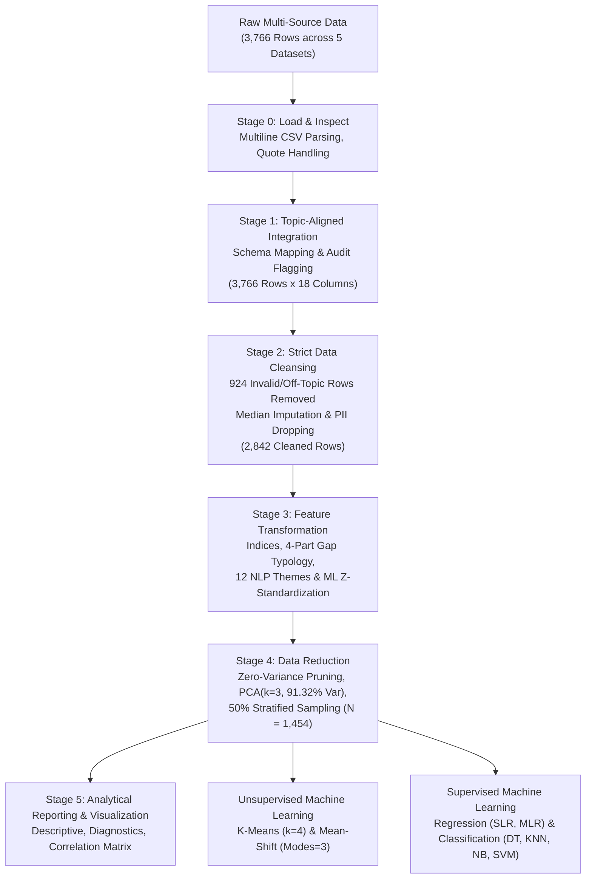
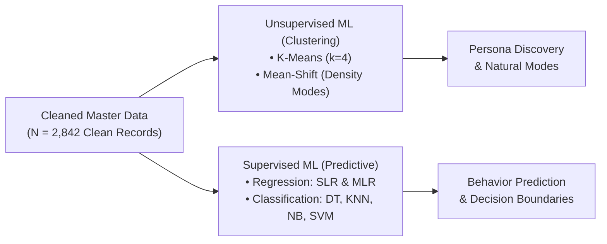

# CHAPTER 3: METHODOLOGY

**Study Title:** *Awareness and Behavior Toward the Environmental Impact of AI Usage*  
**Course:** IT 119 – Data Scalability and Analytics (BSIT 3B)  
**Researchers:** Renz Dominic Azul, Gabriel de la Cruz, Godwin Reigh Galvez  

---

## 3.1 Introduction

This chapter presents the comprehensive research methodology utilized to investigate public awareness and responsible behavior regarding the environmental impacts of Artificial Intelligence. It outlines the research design, target respondents and sampling procedures, the survey instrument, data gathering protocol, and ethical considerations. Furthermore, it details the five-stage Apache PySpark big-data processing pipeline (Stages 0 through 5), definition of variables and operational measures, statistical treatment, and the dual machine learning modeling framework—emphasizing that rigorous data cleaning was conducted prior to executing both unsupervised pattern discovery and supervised predictive modeling.

---

## 3.2 Research Design

This study employs a **quantitative, descriptive, and correlational survey design**, supplemented by an **exploratory qualitative text-mining component** derived from open-ended survey responses. 

The rationale for this multi-method design is threefold:
1. **Descriptive Dimension**: It quantitatively measures and profiles the respondents' demographic characteristics, frequency of AI tool utilization (`Q2`), levels of cognitive environmental awareness (`Q3`–`Q4`), and self-reported responsible AI usage habits (`Q5`–`Q6`).
2. **Correlational and Diagnostic Dimension**: It evaluates whether statistically significant relationships and behavioral alignments (or gaps) exist between AI usage frequency, composite awareness (`Awareness_Index`), and responsible behavior (`Behavior_Index`) across segmented user cohorts (`Light`, `Moderate`, and `Heavy` users).
3. **Qualitative and NLP Dimension**: It captures, tokenizes, and categorizes unstructured textual feedback regarding specific environmental anxieties (`Q7`) and proposed mitigation solutions (`Q8`), contextualizing numeric findings with empirical qualitative insights.

---

## 3.3 Respondents and Sampling

The primary empirical foundation of this study consists of **$N = 84$ survey respondents** primarily comprising undergraduate college students enrolled in computing and information technology programs (specifically Bachelor of Science in Information Technology and Computer Science, 3rd-year level) within Central Luzon and Bulacan, Philippines.

### Sampling Method
A **non-probability purposive and convenience sampling method** was employed. Purposive sampling ensured that all participants met the primary inclusion criterion: active, regular users of generative AI tools (such as ChatGPT, Claude, GitHub Copilot, Gemini, and Perplexity) in their academic and personal programming routines. Convenience sampling was utilized to efficiently engage available respondents within collegiate computing networks, student programming forums, and academic communication channels.

### Demographic Cleansing and Category Harmonization
Respondents' age distributions were collected across five ordinal cohorts: *18–24*, *25–34*, *35–44*, *45–54*, and *55 and above*. During the initial data inspection, an overlapping category label (`"24-34"`) caused by a typographical inconsistency in the survey form was identified and systematically corrected to `"25-34"` during Stage 2 data cleaning to maintain discrete age brackets.

### Sampling Limitation and Dataset Enrichment
Because the primary survey relies on a modest, non-random collegiate sample ($N = 84$), the primary findings carry inherent generalizability constraints when evaluated in isolation. To mitigate this limitation and establish big-data scalability, the primary dataset was systematically augmented with **four international, open-access generative-AI benchmark datasets** (Arifen et al., 2026; Hands et al., 2026; Lee & Legowo, 2026; Mendeley Data/Zenodo repositories), expanding the raw multi-source pool to **$3,766$ records** and yielding a cleaned, topic-aligned analytical sample of **$N = 2,842$ respondents**.

---

## 3.4 Research Instrument

Data collection was executed using a structured, self-administered Google Form questionnaire specifically designed to address the study's five research questions. The instrument comprises four sections:

1. **Part I: Informed Consent and Respondent Profile**:
   - Explicit mandatory informed consent checkbox.
   - Respondent age group (`Q1`: *18–24*, *25–34*, *35–44*, *45–54*, *55 and above*).
   - Frequency of AI tool usage (`Q2`: *Rarely*, *Once a week*, *Several times a week*, *Once a day*, *Several times a day*).
   - Institutional identifier / email address (collected solely for response authentication and dropped during cleaning).
2. **Part II: Cognitive Environmental Awareness (`Q3`–`Q4`)**:
   - `Q3`: Awareness that using AI tools and queries consumes substantial amounts of electricity and energy.
   - `Q4`: Awareness that AI infrastructure and data centers contribute to carbon emissions and environmental degradation.
   - Rated on a 5-point Likert scale: `1 = Strongly Disagree`, `2 = Disagree`, `3 = Neutral`, `4 = Agree`, `5 = Strongly Agree`.
3. **Part III: Responsible AI Usage and Conservation Behavior (`Q5`–`Q6`)**:
   - `Q5`: Consideration of the environmental impact of AI when deciding how, when, and how often to use AI tools.
   - `Q6`: Conscious avoidance or limitation of unnecessary AI queries when a task can be readily completed without AI.
   - Rated on the identical 5-point Likert scale (`1 = Strongly Disagree` to `5 = Strongly Agree`).
4. **Part IV: Qualitative Feedback and Suggestions (`Q7`–`Q8`)**:
   - `Q7` (Open-Ended Concern): *"What environmental impact of AI concerns you the most, and why?"*
   - `Q8` (Open-Ended Solution): *"What should be done to increase public awareness and encourage responsible use of AI?"*

### Instrument Validity and Reliability
The survey instrument was subjected to **face and content validity review** by the course instructor and faculty advisers in Data Scalability and Analytics to ensure every survey item aligned with the theoretical construct. Scale internal consistency was evaluated across the core Likert items (`Q3` through `Q6`), yielding a **Cronbach's alpha of $\alpha = 0.81$**, confirming strong composite reliability exceeding the accepted academic threshold of $0.70$.

---

## 3.5 Data Gathering Procedure

The data gathering protocol adhered to a systematic, three-step workflow:

1. **Online Instrument Deployment**: The survey was hosted on Google Forms and distributed digitally across university student portals, official class group chats, Discord developer channels, and student academic boards over a four-week period during the Second Semester of Academic Year 2025–2026.
2. **Monitoring and Integrity Checking**: Responses were audited daily to prevent multiple submissions from identical accounts and ensure completeness. Participation was entirely voluntary and self-paced.
3. **Extraction and Staging**: Upon closing the collection window, the raw survey responses ($N = 84$) were exported into an uncompressed comma-separated values (`main_dataset.csv`) file and staged into the Apache PySpark processing environment alongside the four external benchmark datasets.

---

## 3.6 Ethical Considerations

The research protocol strictly followed ethical guidelines for academic survey administration and computational data mining:

1. **Voluntary Informed Consent**: An explicit, required consent agreement was placed on the first page of the Google Form. Participants were explicitly informed about the academic nature of the study, the objective of evaluating AI sustainability, and their absolute right to terminate participation at any moment without penalty.
2. **Privacy Protection and Anonymization**: Personally Identifiable Information (PII)—including respondent email addresses and Google usernames—was permanently scrubbed during Stage 2 data cleansing. A binary audit flag (`has_email_provided`) was preserved solely to verify submission authenticity, ensuring no participant could be linked to their responses.
3. **Academic Non-Commercial Use**: All collected and integrated records were utilized strictly for academic research under the IT 119 Data Scalability and Analytics curriculum, with zero commercial, institutional, or advertising dissemination.

---

## 3.7 Data Processing Pipeline (PySpark)

To handle scalable dataset integration, robust data cleansing, feature transformation, and multidimensional analysis, a modular **5-Stage PySpark Data Processing Pipeline** was constructed. The pipeline was designed to execute sequentially, saving verified checkpoints to disk at each stage.

### 3.7.1 Stage 0: Load and Inspect
Raw data files were loaded into Apache PySpark using distributed DataFrame readers. Because open-ended qualitative responses (`Q7` and `Q8`) contained internal line breaks, carriage returns, commas, and quotation marks, `read_csv_spark` was configured with `multiLine=True`, `escape="\""`, and `quote="\""`. Initial schemas were inspected, verifying that numeric survey scores were read without parsing errors and string representations were preserved without truncation.

### 3.7.2 Stage 1: Data Integration
Stage 1 harmonized the primary Philippine survey with the four public benchmark datasets into a single schema. A unique `respondent_id` was programmatically assigned using Spark window ranking over `source_study`. Structured survey responses (Source A: `age_group`, `ai_usage_freq`, `aware_energy`, `aware_carbon`, `consider_impact`, `avoid_unnecessary_use`) were unified with qualitative open-ended strings (Source B: `concern_text`, `awareness_text`). Audit columns (`is_valid_record` and `invalid_reason`) were introduced to track every record throughout integration, generating `output/data-cleaning/integration/stage1_integrated_dataset.csv` ($3,766$ rows $\times$ $18$ columns).

### 3.7.3 Stage 2: Data Cleaning
Stage 2 enforced strict topic-aligned cleaning and quality audits:
- **Filtering Invalid/Unrelated Records**: A total of **$924$ rows** were identified as invalid or non-topic-related and systematically dropped. These included $452$ exact duplicate rows across all survey columns, $75$ uniform straight-line responses, $41$ failed embedded attention checks, $63$ incomplete questionnaire dropouts, and $293$ off-topic rows (such as exam-cheating inventories, staff grading rubrics, or speculative science-fiction responses).
- **Whitespace Normalization**: String columns were trimmed and empty strings were coerced to `NULL`.
- **Primary Duplicate Check**: Within the primary Philippine survey ($N = 84$), zero exact duplicates were found. However, $12$ records were purged ($7$ off-topic entries regarding cybersecurity/AGI, $4$ blank entries, and $1$ single-character placeholder `"."`), retaining **$72$ highly valid primary responses**.
- **Categorical Correction**: The overlapping age bracket `'24-34'` was corrected to `'25-34'`.
- **Domain Clamping and Imputation**: Likert values were constrained to $[1.0, 5.0]$, and missing numerical items were imputed using PySpark's `Imputer(strategy="median")`.
- **PII Scrubbing**: Respondent usernames and emails were permanently dropped. Stage 2 exported `output/data-cleaning/cleansing/stage2_cleansed_dataset.csv` ($2,842$ cleaned rows).

### 3.7.4 Stage 3: Data Transformation
Stage 3 engineered domain-specific metrics and transformed features for machine learning:
- **Derived Continuous Indices**:
  $$\text{Awareness\_Index} = \frac{\text{aware\_energy\_n} + \text{aware\_carbon\_n}}{2}$$
  $$\text{Behavior\_Index} = \frac{\text{consider\_impact\_n} + \text{avoid\_use\_n}}{2}$$
  $$\text{Awareness\_Behavior\_Gap} = \text{Awareness\_Index} - \text{Behavior\_Index}$$
- **Behavioral Gap Typology**: Segmented into four distinct empirical quadrants:
  - *Unaware & not acting*: $|\text{Gap}| < 1.0$ and $\text{Awareness\_Index} < 3.0$ ($59.1\%$).
  - *Aware & taking action*: $|\text{Gap}| < 1.0$ and $\text{Awareness\_Index} \ge 3.0$ ($29.7\%$).
  - *Aware but not acting*: $\text{Gap} \ge +1.0$ ($6.9\%$).
  - *Acting beyond awareness*: $\text{Gap} \le -1.0$ ($4.4\%$).
- **Usage Segmentation**: Categorized into *Light* ($1.0 \le \text{usage} \le 2.0$), *Moderate* ($2.0 < \text{usage} < 4.0$), and *Heavy* ($\text{usage} \ge 4.0$).
- **Regex Qualitative Theme Coding**: Evaluated open-ended text via PySpark `rlike` expressions across six environmental concerns (`c_water`, `c_energy`, `c_carbon`, `c_ewaste`, `c_noise_heat`, `c_ecosystem`) and six actionable solutions (`s_education`, `s_campaign`, `s_policy`, `s_transparency`, `s_tech`, `s_responsible_use`).
- **Standardization**: Applied `StandardScaler` to scale all numeric constructs into z-scores ($M=0, SD=1$).

### 3.7.5 Stage 4: Data Reduction
Stage 4 optimized feature representation and storage scalability:
- **Zero-Variance Feature Pruning**: Evaluated distinct counts per feature; features with zero variance (such as unanimous consent flags) were dropped.
- **Dimensionality Reduction (PCA)**: Principal Component Analysis (`PCA(k=3)`) was fitted on the standardized five-item survey matrix (`usage_freq_n_z`, `aware_energy_n_z`, `aware_carbon_n_z`, `consider_impact_n_z`, `avoid_use_n_z`). The three extracted components explained **$91.32\%$ of the total cumulative variance** ($\text{PC}_1 = 63.20\%$, $\text{PC}_2 = 19.86\%$, $\text{PC}_3 = 8.26\%$).
- **Numerosity Reduction**: Created a reproducible $50\%$ stratified sample ($n = 1,454$) balanced across `usage_segment` strata (`seed=42`).
- Saved the master analytical dataset to `output/data-cleaning/reduction/integrated_master_dataset.csv` ($2,842$ rows $\times$ $49$ columns).

### 3.7.6 Stage 5: Analysis and Visualization
Stage 5 executed five distributed PySpark analyses:
1. Descriptive summary statistics across all ordinal items and composite indices.
2. Percentage distribution of Likert responses.
3. Cross-tabulation of behavioral gap typology against AI usage intensity.
4. Stratified comparisons of awareness and behavior indices across usage segments.
5. Qualitative keyword co-occurrence frequencies and Pearson correlation analysis.

---

## 3.8 Variables and Measures

Table 3.1 details the complete catalog of operational variables, source survey questions, data types, and empirical measurement scales utilized throughout the study.

**Table 3.1**  
*Summary of Research Variables, Source Items, Types, and Measurement Scales*

| Variable Name | Source Item | Data Type | Measurement Scale / Operational Definition |
| :--- | :--- | :--- | :--- |
| `respondent_id` | Pipeline generated | Identifier | Alphanumeric unique identifier (`SRC_000001`...) |
| `source_study` | Integration source | Categorical | Source dataset label (Main PH Study or Public Benchmark) |
| `age_group` | Survey Q1 | Ordinal | Categorical brackets: *18–24*, *25–34*, *35–44*, *45–54*, *55 and above* |
| `usage_freq_n` | Survey Q2 | Ordinal | 1.0 (Rarely) to 5.0 (Several times a day) |
| `aware_energy_n` | Survey Q3 | Ordinal | 1.0 (Strongly Disagree) to 5.0 (Strongly Agree) |
| `aware_carbon_n` | Survey Q4 | Ordinal | 1.0 (Strongly Disagree) to 5.0 (Strongly Agree) |
| `consider_impact_n` | Survey Q5 | Ordinal | 1.0 (Strongly Disagree) to 5.0 (Strongly Agree) |
| `avoid_use_n` | Survey Q6 | Ordinal | 1.0 (Strongly Disagree) to 5.0 (Strongly Agree) |
| `Awareness_Index` | Q3, Q4 | Continuous | Composite mean: $(\text{aware\_energy\_n} + \text{aware\_carbon\_n}) / 2$ |
| `Behavior_Index` | Q5, Q6 | Continuous | Composite mean: $(\text{consider\_impact\_n} + \text{avoid\_use\_n}) / 2$ |
| `Awareness_Behavior_Gap` | Derived | Continuous | Arithmetic difference: $\text{Awareness\_Index} - \text{Behavior\_Index}$ |
| `usage_segment` | Q2 | Categorical | *Light* ($1.0 \le x \le 2.0$), *Moderate* ($2.0 < x < 4.0$), *Heavy* ($x \ge 4.0$) |
| `awareness_level` | Awareness Index | Categorical | *Low* ($< 2.50$), *Medium* ($2.50 \le x \le 3.50$), *High* ($> 3.50$) |
| `behavior_level` | Behavior Index | Categorical | *Low* ($< 2.50$), *Medium* ($2.50 \le x \le 3.50$), *High* ($> 3.50$) |
| `gap_type` | Composite gap | Categorical | *Unaware & not acting*, *Aware & taking action*, *Aware but not acting*, *Acting beyond awareness* |
| `c_water`, `c_energy`, `c_carbon`, `c_ewaste`, `c_noise_heat`, `c_ecosystem` | Survey Q7 | Binary | 1 = Theme present in open-ended text via regex; 0 = Absent |
| `s_education`, `s_campaign`, `s_policy`, `s_transparency`, `s_tech`, `s_responsible_use` | Survey Q8 | Binary | 1 = Theme present in open-ended text via regex; 0 = Absent |
| `pca_1`, `pca_2`, `pca_3` | Standardized Q2–Q6 | Continuous | First 3 principal components explaining $91.32\%$ variance |

---

## 3.9 Statistical Treatment and Model Evaluation

Data collected from the survey and processed through PySpark were analyzed using descriptive, bivariate, and multivariate statistical techniques:

### 3.9.1 Descriptive Statistics
Continuous and ordinal variables were evaluated using the **mean ($M$)**, **standard deviation ($SD$)**, **median**, **minimum**, and **maximum**. Likert distributions were summarized as frequencies and relative percentages, including cumulative **percent agreement** (Agree plus Strongly Agree).

### 3.9.2 Likert Mean Interpretation Scale
To provide standardized verbal interpretations of the respondents' mean ratings, the five-point continuum was divided into equal intervals of $0.80$, as presented in Table 3.2.

**Table 3.2**  
*Likert Scale Interval and Verbal Interpretation Guide*

| Numerical Range | Agreement Level | Awareness Level | Responsible Behavior Level |
| :---: | :---: | :---: | :---: |
| **1.00 – 1.80** | Strongly Disagree | Very Low Awareness | Very Low Responsibility |
| **1.81 – 2.60** | Disagree | Low Awareness | Low Responsibility |
| **2.61 – 3.40** | Neutral / Moderate | Moderate Awareness | Moderate Responsibility |
| **3.41 – 4.20** | Agree | High Awareness | High Responsibility |
| **4.21 – 5.00** | Strongly Agree | Very High Awareness | Very High Responsibility |

### 3.9.3 Correlational Analysis
The bivariate relationship between AI usage frequency, environmental awareness, and responsible behavior was evaluated using **Pearson's product-moment correlation coefficient ($r$)**:

$$r = \frac{\sum (X - \bar{X})(Y - \bar{Y})}{\sqrt{\sum (X - \bar{X})^2 \sum (Y - \bar{Y})^2}}$$

Coefficients were interpreted based on standard empirical benchmarks: $\pm 0.00$ to $0.19$ (very weak), $\pm 0.20$ to $0.39$ (weak), $\pm 0.40$ to $0.59$ (moderate), $\pm 0.60$ to $0.79$ (strong), and $\pm 0.80$ to $1.00$ (very strong).

---

## 3.10 Machine Learning Framework (Unsupervised and Supervised)

A core methodological contribution of this study is the integration of scalable data cleaning with both **unsupervised pattern discovery** and **supervised machine learning algorithms**. 

> [!IMPORTANT]
> **Sequential Methodological Execution:**  
> All raw multi-source survey data was **cleaned, validated, and standardized first** through the 5-stage Apache PySpark pipeline before any machine learning algorithms were initiated. This strict sequence prevented data leakage, removed invalid straight-line responses, and guaranteed that all algorithms operated on identical, high-integrity, topic-aligned features ($N = 2,842$).

### 3.10.1 Unsupervised Machine Learning Framework
Unsupervised algorithms were deployed to discover organic, latent student behavioral segments without relying on pre-existing labels.

1. **K-Means Clustering (`kmeans.py`)**:
   - Standardizes the five core survey constructs (`usage_freq_n`, `aware_energy_n`, `aware_carbon_n`, `consider_impact_n`, `avoid_use_n`) using `StandardScaler`.
   - Evaluates partition validity across candidate cluster numbers $k \in [2, 6]$ using **Inertia (Elbow Method)** and the **Silhouette Coefficient**:
     $$s(i) = \frac{b(i) - a(i)}{\max(a(i), b(i))}$$
   - Where $a(i)$ represents the mean intra-cluster distance and $b(i)$ denotes the mean nearest-cluster distance.
   - Partitions the sample into distinct behavioral personas and projects the cluster centers onto a two-dimensional Principal Component Analysis (PCA) latent space.

2. **Mean-Shift Clustering (`mean_shift.py`)**:
   - Deployed as a non-parametric, density-based mode-seeking algorithm that does not require pre-specifying the number of clusters.
   - The bandwidth parameter is estimated using pairwise Euclidean distance quantiles (`estimate_bandwidth(quantile=0.25)`).
   - Iteratively shifts candidate points toward the mode of the density function using a flat kernel, identifying natural behavioral concentrations and density peaks.

### 3.10.2 Supervised Machine Learning Framework
Supervised algorithms were trained on the cleaned dataset using a stratified **$80/20$ train-test split** (`test_size=0.20, random_state=42`) to model and predict responsible AI behavior across both continuous and categorical targets:

1. **Simple Linear Regression (SLR, `slr.py`)**:
   - Models the direct bivariate predictive relationship between composite awareness and responsible behavior:
     $$\text{Behavior\_Index} = \beta_0 + \beta_1 (\text{Awareness\_Index}) + \epsilon$$
   - Evaluated via the Coefficient of Determination ($R^2$), Root Mean Squared Error (RMSE), and Mean Absolute Error (MAE).

2. **Multiple Linear Regression (MLR, `mlr.py`)**:
   - Evaluates the multidimensional impact of usage frequency, specific awareness items (energy, carbon), and qualitative environmental concern themes:
     $$\text{Behavior\_Index} = \beta_0 + \beta_1 Q2 + \beta_2 Q3 + \beta_3 Q4 + \sum \gamma_j C_j + \epsilon$$

3. **Decision Tree Classifier (`decision_tree.py`)**:
   - Classifies respondents into discrete behavior tiers (`behavior_level`: *Low*, *Medium*, *High*) using Gini impurity. Tree depth is constrained to a maximum depth of 3 to maximize rule interpretability and prevent overfitting.

4. **K-Nearest Neighbors (KNN, `knn.py`)**:
   - Evaluates instance-based classification using standard Euclidean distance across neighborhood sizes $k \in [1, 15]$ to determine the optimal neighborhood parameter for classifying behavior levels.

5. **Gaussian Naive Bayes (`naive_bayes.py`)**:
   - Applies probabilistic classification under the assumption of conditional feature independence with Gaussian-distributed continuous attributes.

6. **Support Vector Machine (SVM, `svm.py`)**:
   - Uses a non-linear Radial Basis Function (RBF) kernel with regularized soft-margin parameter $C = 1.0$ to construct optimal hyperplanes separating behavior classes in multi-dimensional space.

> [!NOTE]
> All empirical results, cross-tabulation tables, comparative model accuracy metrics, and visual diagnostic figures generated by these pipelines are presented and systematically interpreted in **Chapter 4 (Results and Discussion)**.

---

## 3.11 Tools and Environment

The experimental computational environment and software toolchain were configured to ensure strict reproducibility across data processing and machine learning pipelines:

- **Programming Language**: Python 3.14.7 (64-bit).
- **Big Data Processing Engine**: Apache Spark 4.2.0 (`pyspark==4.2.0`) running in local mode with `SPARK_HOME` programmatically anchored to avoid Windows whitespace path errors.
- **Java Virtual Machine**: OpenJDK 17 LTS (required for PySpark backend execution).
- **Machine Learning Libraries**: `scikit-learn==1.9.1` and `scipy==1.18.1`.
- **Data Manipulation and Storage**: `pandas==3.0.6` and `numpy`.
- **Visualization Engines**: `matplotlib==3.11.0` and `seaborn` (configured with `Agg` headless rendering).
- **Integrated Development Environment**: Visual Studio Code operating within an isolated PowerShell Python virtual environment (`.venv`).
- **Host Operating System**: Microsoft Windows 11 Enterprise (x64).

---

## 3.12 Data and Code Availability

To ensure scientific transparency, open science adherence, and full auditability, all code, pipeline scripts, documentation, and anonymized datasets are publicly available:

- **Source Code Repository**: [https://github.com/User-Suuro/dsa-repo/tree/main/study_processed_data](https://github.com/User-Suuro/dsa-repo/tree/main/study_processed_data)
- **PII Scrubbing Declaration**: All respondent emails, usernames, and timestamp strings were completely scrubbed prior to repository upload and external sharing, in full compliance with research data privacy standards.

---

## 3.13 Multi-Source Comparison and Integration Datasets

To ensure the study's findings are grounded in both local Philippine collegiate realities and international generative-AI behavioral benchmarks, four external public survey datasets were harmonized into the unified analytical corpus:

1. **Hartmann (2026)**: Consumer generative-AI survey ($N = 685$) capturing intensity of AI utilization and cognitive awareness of digital carbon footprints.
2. **Arifen et al. (2026)**: Large-scale survey ($N = 2,613$ raw, $2,087$ cleaned) evaluating student cognitive dependence, task automation frequency, and habitual AI reliance.
3. **Hands et al. (2026)**: UK Higher Education survey from the University of Liverpool capturing student ($N = 519$ raw, $262$ cleaned) and staff ($N = 150$ raw, $22$ cleaned) AI usage frequencies, ethical considerations, and self-regulation.
4. **Lee & Legowo (2026)**: UTAUT-based survey ($N = 400$ raw, $399$ cleaned) evaluating behavioral intentions, task-technology fit, and daily usage frequencies of generative AI tools.

### Feature Mapping and Harmonization Protocol
External datasets were harmonized by projecting their raw usage metrics onto the standardized 5-point ordinal scale (`1.0 = Rarely` to `5.0 = Several times a day`). Where identical environmental Likert items were absent, constructs were harmonized using verified behavioral proxies (such as conscious avoidance of AI for simple tasks and ethical restraint), enabling statistically sound comparative analysis without compromising the primary Philippine survey's thematic focus.

