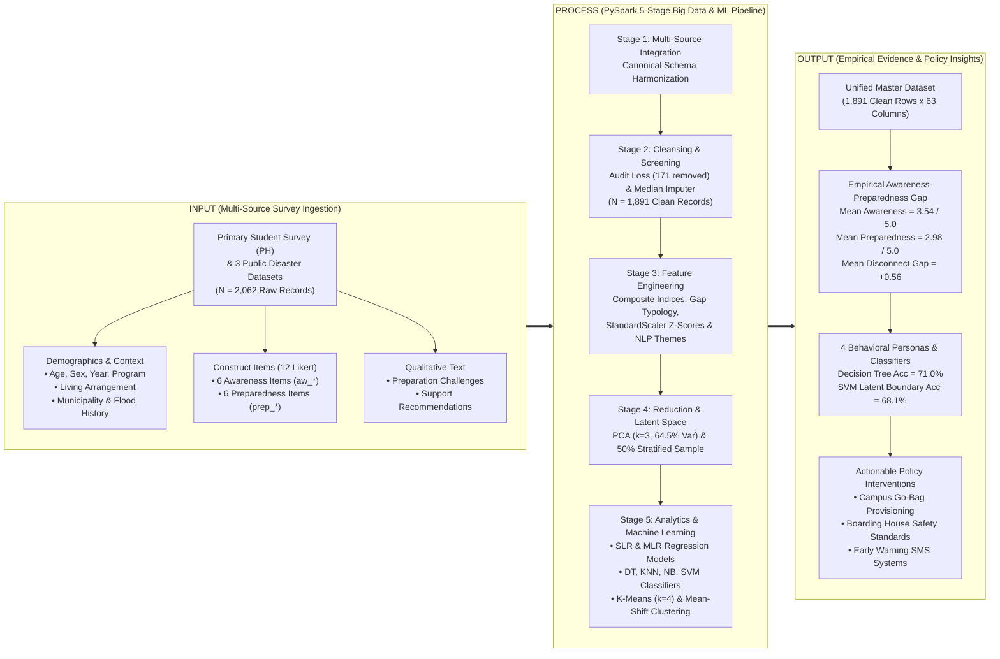

# CHAPTER I: INTRODUCTION

**Study Title:** *Analyzing College Students' Awareness and Preparedness Toward Flood Risks in the Philippines: A Data Science Approach*  
**Course:** BSIT 3A – IT 119: Data Scalability and Analytics  
**Researchers:** John Mark I. Pardo, Byron Boral, Aerold Steven Reyes (Group 11 – Skywalker)  
**Institution:** College of Information and Communications Technology, Camarines Norte, Philippines  

---

## 1.1 Background of the Study

The Philippine archipelago is widely recognized as one of the most disaster-prone nations in the world. Situated directly within the Pacific Typhoon Belt and the Pacific Ring of Fire, the country experiences an average of twenty tropical cyclones annually, approximately eight to nine of which make landfall with catastrophic intensity (PAGASA, 2024; World Bank, 2023). According to the *World Risk Report* (Bündnis Entwicklung Hilft, 2024), the Philippines has consistently ranked first globally in the World Risk Index, driven by extreme exposure to climate-induced hazards, extensive coastlines, low-lying alluvial plains, and high socioeconomic vulnerability. Among recurring natural hazards, hydro-meteorological disasters—predominantly inland, coastal, and urban flooding—generate the most widespread and recurrent devastation, eroding public infrastructure, displacing communities, submerging agricultural lands, and causing extensive loss of life and livelihood (National Disaster Risk Reduction and Management Council [NDRRMC], 2024).

In regional provinces such as Camarines Norte and across low-lying floodplains in Luzon and Metro Manila, flooding is an annual, multi-event reality. Seasonal southwest monsoons (*Habagat*), shear lines, and typhoon-triggered torrential downpours regularly inundate river basins and coastal settlements, paralyzing commercial transport and suspending academic operations (Ravago et al., 2020). While disaster management research has extensively documented the macro-level impacts on local government units (LGUs) and physical infrastructure, a critical and vulnerable demographic group is frequently overlooked in localized disaster planning: **college students and young adults**.

Higher education students represent a unique and transitionary population group. In developing economies, entering tertiary education frequently involves transitioning from the direct protective custody and structured preparedness routines of family households into independent living arrangements. Thousands of college students relocate near university campuses, residing in boarding houses, private dormitories, or rented shared rooms. Many of these student quarters are situated in congested, low-cost, or flood-prone neighborhoods with substandard drainage systems and minimal landlord disaster contingency investments (Segovia & Tungol, 2026). Furthermore, college students face distinct structural constraints: limited personal financial allowances, restricted physical storage space for emergency gear, high academic demands, and a heavy reliance on digital communication and informal social media feeds for real-time weather advisories (Boral et al., 2026; NOAA, 2024). 

Despite being recognized as a digitally connected and educated cohort, empirical evidence suggests a profound behavioral disconnect: **high cognitive knowledge of disaster risks does not automatically translate into tangible personal preparedness actions** (Jelonek & Pawełoszek, 2026). While students may demonstrate solid comprehension of rainfall warnings and flood advisories issued by the Philippine Atmospheric, Geophysical and Astronomical Services Administration (PAGASA), their physical preparedness—such as assembling an emergency survival kit ("Go-Bag"), maintaining a 72-hour supply of non-perishable food and potable water, securing essential documents in waterproof containers, and formalizing family emergency communication plans—remains critically inadequate.

In the academic discipline of **Data Scalability and Analytics (IT 119)**, addressing public disaster vulnerability requires moving beyond conventional small-sample, manual survey analysis. Traditional localized disaster studies are frequently constrained by limited sample sizes ($N < 150$), restricting statistical power and preventing multi-dimensional segmentation across living arrangements, geographic exposure, and prior hazard history. To establish rigorous, generalizable empirical conclusions, modern data science provides scalable computational frameworks capable of integrating primary field surveys with multi-source, open-access disaster research datasets.

This study—**"Analyzing College Students' Awareness and Preparedness Toward Flood Risks in the Philippines: A Data Science Approach"**—investigates the multi-dimensional awareness, personal preparedness, and empirical gap among college students and young adults across a unified, multi-source master dataset ($N = 1,891$ clean valid records harmonized from $2,062$ raw entries). Anchored on primary field survey responses from Camarines Norte college students ($N = 128$) and integrated with three topical public disaster datasets—Segovia & Tungol (2026) Philippine young adult flood exposure survey ($N = 370$ analytic sample), the 2024 Flooding and Society Survey (FL24; $N = 1,200$), and Ravago et al. (2020) Philippine local government risk management data ($N = 193$)—this study executes a 5-stage **Apache PySpark** data engineering pipeline alongside supervised machine learning algorithms and unsupervised clustering personas. The resulting findings provide empirical evidence to inform data-driven campus safety policies, municipal disaster risk reduction programs, and community youth interventions.

---

## 1.2 Statement of the Problem

Although college students and young adults are frequently exposed to heavy seasonal rainfall, typhoon advisories, and urban inundation, their practical readiness to survive and respond effectively to severe flood events remains highly uncertain. Many students possess conceptual awareness of typhoon signals but fail to adopt proactive readiness habits, leaving them acutely vulnerable during emergency evacuations, extended power blackouts, and water supply contamination.

Specifically, this study aims to resolve the following core research questions:

1. **What is the demographic and situational profile of the respondents** in terms of:
   - 1.1. Age group and chronological age;
   - 1.2. Sex / Gender distribution;
   - 1.3. Year level and academic discipline;
   - 1.4. Living arrangement (Living with family/parents, Boarding house/dormitory/rented room, or Living with relatives);
   - 1.5. Municipality and community of residence; and
   - 1.6. Frequency and severity of prior flood experience in their current residence?

2. **What is the level of flood risk awareness among the respondents** across the six canonical awareness dimensions:
   - 2.1. Understanding PAGASA color-coded rainfall warnings and flood advisories (`aw_warning_signals`);
   - 2.2. Regular monitoring of official meteorological bulletins and disaster updates (`aw_monitor_updates`);
   - 2.3. Knowledge of local flood history and terrain vulnerability in their residential zone (`aw_residence_risk`);
   - 2.4. Familiarity with active emergency contact numbers for local disaster response units (MDRRMO/PDRRMO, BFP, PNP, Red Cross) (`aw_emergency_contacts`);
   - 2.5. Knowledge of designated evacuation centers and safe route access (`aw_evac_routes`);
   - 2.6. Awareness of waterborne diseases (e.g., leptospirosis, cholera, gastroenteritis) and flood health hazards (`aw_health_risks`); and
   - 2.7. Overall composite `awareness_score`?

3. **What is the level of personal flood preparedness among the respondents** across the six canonical action dimensions:
   - 3.1. Assembling and maintaining a packed, accessible 72-hour emergency "Go-Bag" (`prep_go_bag`);
   - 3.2. Stockpiling a 3-day supply of non-perishable food provisions and clean drinking water (`prep_food_water`);
   - 3.3. Securing vital academic, legal, and personal documents in waterproof storage (`prep_secure_docs`);
   - 3.4. Establishing a formalized family and peer emergency communication and evacuation protocol (`prep_evac_plan`);
   - 3.5. Proactive adherence to official municipal pre-emptive evacuation orders (`prep_follow_protocols`);
   - 3.6. Knowledge and execution of electrical main breaker shut-off protocols prior to floodwater intrusion (`prep_breaker_cutoff`); and
   - 3.7. Overall composite `preparedness_score`?

4. **Is there a statistically significant difference and empirical gap between flood risk awareness and personal preparedness** (`awareness_preparedness_gap`), and how does this gap distribute across:
   - 4.1. Different living arrangements (independent dormers vs. family-supported students);
   - 4.2. Prior flood experience intensity (frequently flooded vs. never flooded); and
   - 4.3. The empirical **Gap Typology** (*Aligned*, *Aware but Unprepared*, *Prepared beyond Awareness*)?

5. **Using Supervised Machine Learning and Unsupervised Clustering, what empirical predictive models and behavioral personas emerge** to explain preparedness levels and classify student disaster vulnerability?

6. **What specific qualitative challenges (`c_*`) and recommended institutional support mechanisms (`s_*`)** are articulated by students regarding flood readiness constraints and university disaster management?

---

## 1.3 Objectives of the Study

### General Objective
To assess, model, and evaluate the levels of flood risk awareness and personal disaster preparedness among college students and young adults in the Philippines, analyze the empirical awareness-preparedness gap, and identify determinant vulnerability profiles using big data scalable processing in Apache PySpark, supervised machine learning classifiers, and unsupervised clustering algorithms.

### Specific Objectives
1. **To profile the demographic and situational characteristics** of the integrated student and youth population ($N = 1,891$), focusing on age brackets, living arrangements, geographic residence, and prior flood experience history.
2. **To quantify the level of flood risk awareness** across warning signals, official monitoring, residential hazard history, emergency response contacts, evacuation routes, and health risks, deriving composite awareness indices (`awareness_score`, `aw_warning_index`, `aw_local_hazard_index`, `aw_safety_health_index`).
3. **To evaluate the level of personal flood preparedness** across emergency Go-Bag maintenance, 3-day food/water stockpiling, waterproof document storage, evacuation planning, protocol compliance, and electrical cutoff safety, deriving composite preparedness indices (`preparedness_score`, `prep_supplies_index`, `prep_planning_index`).
4. **To examine the statistical relationship and behavioral gap** between awareness and preparedness (`awareness_preparedness_gap`), identifying vulnerable segments across living arrangements and flood experience cohorts.
5. **To deploy Supervised Machine Learning algorithms** (Simple Linear Regression, Multiple Linear Regression, Decision Tree Classifier, $K$-Nearest Neighbors, Gaussian Naive Bayes, and Support Vector Machine) to predict preparedness scores and classify student readiness levels (`Low`, `Moderate`, `High`).
6. **To discover empirical disaster-response personas** using Unsupervised Clustering ($K$-Means with elbow/silhouette optimization and non-parametric Mean-Shift density mode-seeking) in latent PCA construct space.
7. **To extract and categorize qualitative themes** from open-ended student narratives regarding immediate survival constraints (`c_supplies_food`, `c_financial_cost`, `c_evac_access`, `c_power_comms`, `c_housing_safety`) and prioritized institutional interventions (`s_go_bag_kits`, `s_early_warning_sms`, `s_evac_shelter`, `s_drrm_seminars`, `s_financial_aid`).

---

## 1.4 Conceptual Framework

This study is conceptually grounded in the **Protection Motivation Theory (PMT)** (Rogers, 1975; Prentice-Dunn & Rogers, 1986), the **Cognitive-Behavioral Vulnerability Paradigm** in disaster sociology, and an **Input–Process–Output (IPO)** data science engineering framework.

According to Protection Motivation Theory, individuals faced with environmental threats undergo two cognitive appraisal pathways:
1. **Threat Appraisal**: Evaluating the severity of the hazard and one's personal exposure/vulnerability to it (represented in this study by Flood Risk Awareness, PAGASA warning comprehension, residence hazard knowledge, and prior flood exposure).
2. **Coping Appraisal**: Evaluating one's self-efficacy and response capacity to implement protective actions (represented by personal preparedness actions, emergency supplies, Go-Bag readiness, and evacuation planning).

The conceptual model recognizes that while threat awareness is an essential precursor, tangible coping behaviors are frequently hindered by situational impediments (such as living in rented dormitories with minimal control over building infrastructure and financial constraints in procuring emergency supplies).

### Narrative Description of the Framework
1. **Input Phase**: Ingests primary survey data collected from college students in Camarines Norte alongside three curated public datasets from Mendeley Data and Harvard Dataverse (Segovia & Tungol, 2026; NOAA FL24, 2024; Ravago et al., 2020), totaling $2,062$ raw observations. Input features capture demographic attributes, residential settings, 12 standardized 5-point Likert survey items across awareness and preparedness constructs, and open-ended textual narratives.
2. **Process Phase**: Implemented using an enterprise-grade 5-stage **Apache PySpark** and Scikit-Learn architecture:
   - **Stage 1 (Integration)**: Maps heterogeneous columns to canonical variable schemas and logs ingestion audits.
   - **Stage 2 (Cleansing)**: Screened out 171 invalid records (failed attention checks and careless survey patterns from Segovia 2026), clamped Likert responses to $[1.0, 5.0]$, applied PySpark median `Imputer`, and cleansed textual tokens.
   - **Stage 3 (Transformation)**: Derived composite construct scores (`awareness_score`, `preparedness_score`, `awareness_preparedness_gap`, sub-dimensions), segmented behavioral categories (`gap_typology`, `risk_tier`), engineered qualitative regex keyword flags (`c_*`, `s_*`), and normalized features with `StandardScaler`.
   - **Stage 4 (Reduction)**: Conducted zero-variance pruning, compressed the 12 items via Principal Component Analysis (`PCA(k=3)` explaining $64.5\%$ variance), and generated a 50% stratified analytical sample.
   - **Stage 5 (Analytics & Machine Learning)**: Executed descriptive cross-tabulations, six supervised learning models (SLR, MLR, Decision Tree, KNN, Naive Bayes, SVM), and two unsupervised clustering frameworks (K-Means with $k=4$ and non-parametric Mean-Shift).
3. **Output Phase**: Yields the final master dataset (`integrated_master_dataset.csv`, $1,891 \times 63$), quantifies the empirical awareness-to-preparedness disconnect, validates the predictive utility of hazard awareness in forecasting preparedness levels, identifies 4 distinct student disaster personas, and establishes data-driven institutional recommendations.

---

## 1.5 Significance of the Study

Floods represent an existential threat to community welfare, educational continuity, and student safety across the Philippines. By providing empirical, large-scale quantitative evidence regarding the flood risk awareness and preparedness of college students, this study provides direct, tangible value to the following beneficiaries:

- **College Students and Young Adults**: Serves as a vital diagnostic mirror highlighting the dangerous false sense of security that occurs when cognitive awareness of weather advisories is not paired with physical survival gear (such as Go-Bags, potable water reserves, and waterproof document storage). The study provides practical guidelines for self-reliance and household safety.
- **Higher Education Institutions (HEIs) and University Administrators**: Provides academic councils, student affairs offices, and campus disaster committees with localized empirical data. Universities can formulate targeted disaster risk reduction and management (DRRM) modules, organize mandatory simulation drills, and establish emergency relief stockpiles specifically catering to dormers and off-campus boarders.
- **Dormitory Landlords and Boarding House Operators**: Illuminates the structural vulnerabilities experienced by tenants residing in rented off-campus housing. Landlords can utilize these findings to implement basic safety standards, including elevated storage racks, emergency egress mapping, clear electrical shut-off protocols, and secondary power solutions.
- **Local Government Units (LGUs) and Disaster Risk Reduction and Management Offices (MDRRMO / PDRRMO)**: Offers municipal planners and emergency responders high-resolution insights into the spatial distribution of student vulnerability, enabling targeted early-warning SMS dissemination, designated youth-accessible evacuation centers, and prioritized rescue zoning in university belts.
- **Parents, Families, and Community Caretakers**: Encourages open family dialogues regarding emergency communication protocols, reunification meeting locations, and financial provisions for independent student emergency survival kits.
- **Data Science and Disaster Resilience Researchers**: Demonstrates a reproducible, scalable methodology for harmonizing heterogeneous, multi-source survey datasets using Apache PySpark. The study delivers an open-access, clean benchmark dataset ($N = 1,891$) and a comprehensive supervised and unsupervised machine learning workflow for future disaster analytics research.

---

## 1.6 Scope and Delimitations

### Scope of the Study
- **Thematic Focus**: The investigation focuses strictly on college students' and young adults' cognitive awareness of flood risks (meteorological warning comprehension, monitoring habits, local hazard recognition, emergency response contacts, evacuation routes, waterborne health risks) and their tangible personal preparedness actions (emergency Go-Bag readiness, 3-day water/food stockpiling, waterproof document storage, family evacuation plans, emergency protocol compliance, electrical cutoff protocols).
- **Dataset and Sample Architecture**: The study integrates a primary survey of college students in Camarines Norte, Philippines ($N = 128$) with three topically-aligned public disaster datasets from Mendeley Data and Harvard Dataverse:
  1. *Segovia & Tungol (2026)*: Philippine Young Adults Flood Exposure Survey ($N = 541$ raw $\to$ $370$ clean analytic cases, mean age $21.0$ years);
  2. *NOAA / IPPRA (2024)*: 2024 Flooding and Society Survey (FL24; $N = 1,200$ standardized survey records);
  3. *Ravago et al. (2020)*: Philippine Local Government Disaster Risk Management Survey ($N = 193$ municipality records).
  The consolidated pool comprises **$2,062$ raw entries**, which cleanses to a finalized master dataset of **$1,891$ valid, topic-aligned records**.
- **Computational and Analytical Tools**: The analytical workflow is implemented in Python utilizing **Apache PySpark 4.3.0** on a dedicated local environment. Machine learning workflows incorporate Scikit-Learn for supervised classification/regression (SLR, MLR, Decision Tree, KNN, Naive Bayes, SVM) and unsupervised clustering (K-Means, Mean-Shift), complemented by Matplotlib and Seaborn for high-resolution visualization.

### Delimitations of the Study
- **Exclusion of Careless / Screened Responses**: In Stage 2, 171 records from the Segovia (2026) dataset that failed stringent internal validity criteria (inattention filters, straight-line answering, careless response indicators) were screened out and logged in an external audit table (`stage2_cleaning_loss_log.csv`) to protect analytical integrity.
- **Self-Reported Likert Measurements**: Survey items are measured via standardized 5-point self-reported Likert scales ($1.0 = \text{Strongly Disagree}$ to $5.0 = \text{Strongly Agree}$) and self-reported numerical flood counts, reflecting respondents' perceptions and reported behaviors rather than continuous physical sensor monitoring.
- **Cross-Sectional Methodology**: Data collection represents a cross-sectional snapshot of student awareness and preparedness at a single point in time, identifying statistical associations, regressions, and cluster memberships rather than establishing longitudinal causality.
- **Geographic Representation**: While the primary survey directly represents college students in Camarines Norte and the integrated public sets capture young adults in Metro Manila, Central Luzon, and standardized disaster cohorts, localized flood vulnerabilities may vary according to micro-topographical elevation and drainage characteristics across individual barangays.

---

## 1.7 Definition of Terms

To ensure conceptual precision, methodological clarity, and technical consistency, the following core terms are defined conceptually and operationally:

1. **Flood Risk Awareness (`awareness_score`)**:
   - *Conceptual*: The cognitive understanding, recognition, and mental comprehension an individual possesses regarding flood hazards, meteorological alert systems, terrain vulnerabilities, emergency contacts, and waterborne disease vectors.
   - *Operational*: The composite arithmetic mean of six standardized 5-point Likert items (`aw_warning_signals`, `aw_monitor_updates`, `aw_residence_risk`, `aw_emergency_contacts`, `aw_evac_routes`, `aw_health_risks`), computed as:
     $$\text{awareness\_score} = \frac{\sum_{i=1}^{6} \text{aw\_item}_i}{6.0}$$
     Scores are categorized into `Low` ($< 2.50$), `Moderate` ($2.50 \le x \le 3.75$), and `High` ($> 3.75$).

2. **Personal Flood Preparedness (`preparedness_score`)**:
   - *Conceptual*: The tangible, proactive physical measures, behavioral routines, and logistical arrangements maintained by an individual to safeguard life, health, and property before, during, and immediately following a flood disaster.
   - *Operational*: The composite arithmetic mean of six standardized 5-point Likert items (`prep_go_bag`, `prep_food_water`, `prep_secure_docs`, `prep_evac_plan`, `prep_follow_protocols`, `prep_breaker_cutoff`), computed as:
     $$\text{preparedness\_score} = \frac{\sum_{i=1}^{6} \text{prep\_item}_i}{6.0}$$
     Categorized into `Low` ($< 2.50$), `Moderate` ($2.50 \le x \le 3.75$), and `High` ($> 3.75$).

3. **Emergency Go-Bag (`prep_go_bag`)**:
   - *Conceptual*: A dedicated, pre-packed, portable emergency survival kit containing essential supplies designed to sustain an individual independently for at least 72 hours during an immediate evacuation.
   - *Operational*: A self-reported Likert item ($1.0$ to $5.0$) evaluating whether the respondent maintains an accessible Go-Bag stocked with flashlights, whistles, first-aid supplies, batteries, personal medications, and thermal blankets.

4. **Awareness–Preparedness Gap (`awareness_preparedness_gap`)**:
   - *Conceptual*: The behavioral disconnect observed when an individual's conceptual knowledge of environmental hazards outpaces their actual implementation of protective survival actions.
   - *Operational*: The arithmetic difference computed as:
     $$\text{awareness\_preparedness\_gap} = \text{awareness\_score} - \text{preparedness\_score}$$
     A positive value ($> 0$) indicates cognitive awareness exceeding tangible preparedness.

5. **Gap Typology (`gap_typology`)**:
   - *Conceptual*: A tripartite categorical segmentation classifying respondents based on the degree of alignment or disparity between what they know and what they execute.
   - *Operational*: Segmented into three mutually exclusive classes:
     - **Aligned**: $|\text{Gap}| \le 0.50$ (Awareness and preparedness levels are balanced);
     - **Aware but Unprepared**: $\text{Gap} > +0.50$ (Possesses moderate-to-high awareness but deficient preparedness);
     - **Prepared beyond Awareness**: $\text{Gap} < -0.50$ (Maintains active preparedness measures exceeding technical hazard knowledge).

6. **Risk Tier (`risk_tier`)**:
   - *Conceptual*: An empirical vulnerability index combining physical environmental hazard exposure with household resource deficits.
   - *Operational*: A diagnostic classification where respondents with $\ge 3$ prior flood experiences and an emergency supplies index $< 3.0$ are classified as **High Risk**; respondents meeting either criterion as **Moderate Risk**; and all others as **Low Risk / Resilient**.

7. **Living Arrangement Vulnerability (`living_arrangement`)**:
   - *Conceptual*: The residential context influencing a student's degree of autonomy, financial resources, and physical control over disaster protective measures.
   - *Operational*: Categorized as `Living with family/parents`, `Boarding house/dormitory/rented room`, or `Living with relatives`.

8. **Qualitative Preparation Challenges (`c_*`)**:
   - *Conceptual*: Self-identified structural, economic, and logistical barriers that impede students from executing personal disaster readiness.
   - *Operational*: Open-ended responses classified via PySpark regex (`rlike`) text mining into five binary indicators: `c_supplies_food` (food/water shortages), `c_financial_cost` (budget constraints), `c_evac_access` (flooded transit routes), `c_power_comms` (electrical/telecom blackouts), and `c_housing_safety` (structural leaks and roof flooding).

9. **Qualitative Institutional Support (`s_*`)**:
   - *Conceptual*: Actionable interventions, supplies, and programs requested by students from university leadership and government agencies.
   - *Operational*: Open-ended responses classified via PySpark `rlike` text mining into five binary indicators: `s_go_bag_kits` (subsidized emergency kits), `s_early_warning_sms` (automated cellular alerts), `s_evac_shelter` (designated safe campus shelters), `s_drrm_seminars` (practical drills/seminars), and `s_financial_aid` (calamity student relief funds).

10. **Five-Stage PySpark Pipeline**:
    - *Operational*: The reproducible big-data architecture deployed in `dsa_final_jm/code/data-cleaning/` consisting of Stage 1 Integration (`01_data_integration.py`), Stage 2 Cleansing (`02_data_cleansing.py`), Stage 3 Transformation (`03_data_transformation.py`), Stage 4 Reduction (`04_data_reduction.py`), and Stage 5 Statistical Analytics and Publication Visualization (`05_data_analysis_and_visualization.py`).

11. **Machine Learning Model Suite**:
    - *Operational*: The analytical suite in `dsa_final_jm/code/` comprising six supervised algorithms (`slr.py`, `mlr.py`, `decision_tree.py`, `knn.py`, `naive_bayes.py`, `svm.py`) and two unsupervised clustering frameworks (`kmeans.py`, `mean_shift.py`).

---

