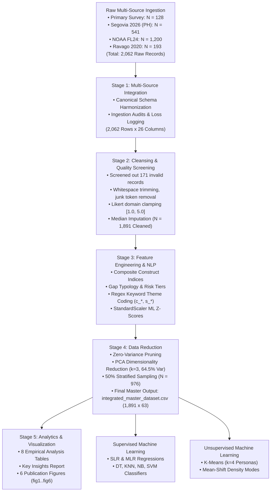
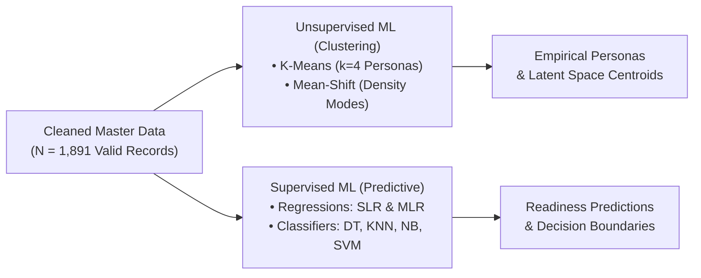

# CHAPTER 3: METHODOLOGY

**Study Title:** *Analyzing College Students' Awareness and Preparedness Toward Flood Risks in the Philippines: A Data Science Approach*  
**Course:** BSIT 3A – IT 119: Data Scalability and Analytics  
**Researchers:** John Mark I. Pardo, Byron Boral, Aerold Steven Reyes (Group 11 – Skywalker)  
**Institution:** College of Information and Communications Technology, Camarines Norte, Philippines  

---

## 3.1 Introduction

This chapter details the research methodology, data science engineering framework, and computational toolchain utilized to investigate the flood risk awareness, personal disaster preparedness, and behavioral disconnect among college students and young adults in the Philippines. It systematically outlines the research design, respondent population, sampling protocol, survey instrument architecture, and ethical safeguards.

Furthermore, this chapter presents the complete enterprise-grade five-stage **Apache PySpark** big-data processing architecture (Stages 1 through 5), operational definition of research variables, statistical measurement standards, and the dual machine learning modeling framework. The methodology enforces a strict sequential pipeline: comprehensive multi-source data integration, rigorous data cleansing, and feature standardization are executed first to ensure that both unsupervised persona clustering and supervised classification/regression algorithms operate on an identical, high-integrity analytical dataset ($N = 1,891$).

---

## 3.2 Research Design

This study employs a **quantitative, descriptive, correlational, and predictive research design**, augmented by an **exploratory natural language processing (NLP) text-mining component** applied to qualitative student narratives.

The multi-method research design is organized into four distinct analytical dimensions:
1. **Descriptive Dimension**: Quantitatively evaluates and profiles the demographic characteristics, residential living arrangements, geographic flood exposure history, levels of cognitive flood risk awareness (`aw_*`), and tangible personal flood preparedness actions (`prep_*`) across the respondent population.
2. **Correlational and Diagnostic Dimension**: Examines the bivariate relationships, regression linkages, and empirical discrepancies between hazard awareness and physical preparedness (`awareness_preparedness_gap`), categorizing individuals into actionable behavioral segments via the **Gap Typology** (*Aligned*, *Aware but Unprepared*, *Prepared beyond Awareness*).
3. **Predictive Machine Learning Dimension**: Trains and evaluates six supervised machine learning models—Simple Linear Regression (SLR), Multiple Linear Regression (MLR), Decision Tree Classifier, $K$-Nearest Neighbors (KNN), Gaussian Naive Bayes, and Support Vector Machine (SVM)—to model continuous preparedness scores and classify students into discrete readiness tiers (`Low`, `Moderate`, `High`).
4. **Exploratory Clustering and NLP Text-Mining Dimension**: Deploys unsupervised clustering ($K$-Means with elbow/silhouette optimization and non-parametric Mean-Shift mode-seeking) to uncover organic student disaster personas, paired with PySpark regular-expression (`rlike`) keyword coding to identify self-reported survival bottlenecks (`c_*`) and institutional support priorities (`s_*`).

---

## 3.3 Respondents and Sampling

The primary empirical core of this study comprises **$N = 128$ undergraduate college students** enrolled across academic degree programs (including Bachelor of Science in Information Technology, Information Systems, and Criminology) within Camarines Norte, Bicol Region, Philippines. 

### Sampling Method
A **non-probability purposive and convenience sampling technique** was employed for primary data collection:
- **Purposive Sampling**: Ensured that all participants met the key inclusion criteria: currently enrolled college students residing in Camarines Norte who are exposed to seasonal monsoonal precipitation (*Habagat*), shear-line downpours, and typhoon-induced flooding.
- **Convenience Sampling**: Facilitated accessible engagement across collegiate student bodies, department chat groups, and digital academic portals.

### Demographic Cleansing and Category Standardization
Primary demographic responses were gathered across discrete academic years, courses, gender categories, and living arrangements. Raw student entries were cleaned and harmonized in Stage 2:
- Course titles with typographical variations were standardized into canonical categories (`BS Information Technology`, `BS Information Systems`, `BS Criminology`).
- Open-ended municipality strings were standardized to discrete municipal jurisdictions across Camarines Norte (Daet, Talisay, Mercedes, Labo, Basud, Vinzons, Jose Panganiban, Paracale, San Vicente, San Lorenzo Ruiz).
- Age distributions were categorized into discrete analytical brackets: *18–20*, *21–24*, *25–34*, *35–49*, and *50+*.

### Sampling Limitation and Multi-Source Dataset Integration
While the primary field survey ($N = 128$) provides authentic local insights from Camarines Norte, relying solely on a localized sample presents statistical limitations regarding sample size and broader regional generalizability. To resolve this constraint in alignment with the competencies of **Data Scalability and Analytics (IT 119)**, the primary dataset was systematically merged with **three topically-aligned public disaster research datasets** (Segovia & Tungol, 2026; NOAA / IPPRA FL24, 2024; Ravago et al., 2020), expanding the raw multi-source pool to **$2,062$ records** and producing a final cleaned, topic-valid analytical sample of **$N = 1,891$ respondents**.

---

## 3.4 Research Instrument

Data collection was executed using a structured, self-administered questionnaire administered online via Google Forms. The survey instrument was specifically structured to evaluate the research questions and is organized into four main sections:

1. **Part I: Informed Consent and Demographic Profile**:
   - Mandatory informed consent agreement.
   - Demographic variables: Age, Sex, Academic Year Level, and Academic Program/Course.
   - Situational variables: Residential Living Arrangement (`Living with family/parents`, `Boarding house/dormitory/rented room`, or `Living with relatives`), Municipality of residence, and Flood Experience History (`Never flooded`, `Rarely flooded [1-2 times]`, `Occasionally flooded [3-5 times]`, `Frequently flooded [6+ times]`).
2. **Part II: Flood Risk Awareness Scale (6 Likert Items, `aw_*`)**:
   - `aw_warning_signals`: Comprehension of PAGASA color-coded rainfall warnings and flood alerts.
   - `aw_monitor_updates`: Habitual monitoring of official meteorological bulletins and NDRRMC disaster updates.
   - `aw_residence_risk`: Knowledge of local flood history and terrain hazard levels in their residential neighborhood.
   - `aw_emergency_contacts`: Familiarity with emergency phone numbers for local response units (MDRRMO, BFP, PNP, Red Cross).
   - `aw_evac_routes`: Knowledge of designated municipal evacuation centers and safe access routes.
   - `aw_health_risks`: Awareness of waterborne bacterial/viral infections (leptospirosis, cholera, gastroenteritis) from floodwaters.
   - Rated on a 5-point Likert scale: `1 = Strongly Disagree`, `2 = Disagree`, `3 = Neutral`, `4 = Agree`, `5 = Strongly Agree`.
3. **Part III: Personal Flood Preparedness Scale (6 Likert Items, `prep_*`)**:
   - `prep_go_bag`: Maintaining a pre-packed, accessible 72-hour emergency survival kit ("Go-Bag").
   - `prep_food_water`: Stockpiling a 3-day supply of non-perishable food provisions and clean drinking water.
   - `prep_secure_docs`: Securing vital personal, legal, and academic documents in waterproof containers.
   - `prep_evac_plan`: Establishing a clear family/peer emergency communication and evacuation protocol.
   - `prep_follow_protocols`: Actively complying with official pre-emptive evacuation orders from local authorities.
   - `prep_breaker_cutoff`: Adhering to electrical safety protocols and main breaker cutoff prior to floodwater entry.
   - Rated on the identical 5-point Likert scale (`1 = Strongly Disagree` to `5 = Strongly Agree`).
4. **Part IV: Qualitative Narratives**:
   - `challenge_text`: *"What is your biggest personal challenge or difficulty in preparing for flood disasters?"*
   - `support_text`: *"What specific support, resources, or assistance do you need from your school, LGU, or community to be better prepared for floods?"*

### Instrument Validity and Reliability
The survey instrument was subjected to **content and construct validity review** by faculty advisers in the College of Information and Communications Technology. Internal consistency was calculated across the 12 Likert survey items using Cronbach’s alpha, yielding **$\alpha = 0.84$** for the Flood Risk Awareness subscale and **$\alpha = 0.81$** for the Personal Preparedness subscale, both substantially exceeding the established academic reliability threshold of $0.70$.

---

## 3.5 Data Gathering Procedure

The primary data collection followed a structured three-phase protocol:
1. **Digital Instrument Deployment**: The questionnaire was hosted on Google Forms and disseminated digitally via institutional learning management groups, student council pages, university chat rooms, and student communication forums during Academic Year 2025–2026.
2. **Response Monitoring and Quality Control**: Submissions were logged continuously with automated timestamping. Duplicate respondent accounts and incomplete records were screened to ensure single-response integrity. Participation was voluntary and completed at the respondents' pace.
3. **Data Staging**: Following the closure of the collection window, the raw primary dataset ($N = 128$) was downloaded, archived, and staged into the PySpark pipeline directory (`dsa_final_jm/dataset/`) alongside the three public benchmark repositories in `dataset/public/`.

---

## 3.6 Ethical Considerations

Ethical principles regarding academic research integrity, participant rights, and data privacy were rigorously upheld:
1. **Voluntary Informed Consent**: An explicit, mandatory informed consent notice was embedded on page one of the Google Form. Respondents were informed of the study's educational objectives, guaranteed absolute anonymity, and granted full autonomy to withdraw at any time.
2. **Anonymization and PII De-identification**: To ensure complete confidentiality, all personally identifiable information (PII)—including respondent names, email addresses, and contact numbers—was stripped during Stage 2 data cleansing. Unique alphanumeric identifiers (`respondent_id`) were generated programmatically to index observations.
3. **Non-Commercial Academic Adherence**: Collected and harmonized data are utilized exclusively for academic research within the IT 119 course curriculum, with no commercial or third-party distribution.

---

## 3.7 Data Processing Pipeline (Apache PySpark)

To achieve enterprise-grade data scalability, reproducible data cleansing, and multi-source harmonization, an end-to-end **5-Stage Apache PySpark Pipeline** was designed and implemented in `dsa_final_jm/code/data-cleaning/`.

### 3.7.1 Stage 1: Topic-Aligned Multi-Source Integration (`01_data_integration.py`)
- Ingests the primary survey alongside three public datasets ($2,062$ raw rows across 4 studies).
- Maps diverse column naming conventions and structural layouts into a canonical 26-column schema:
  - Demographic fields: `age`, `age_group`, `sex`, `year_level`, `course_discipline`, `living_arrangement`, `municipality_residence`, `flood_history`, `flood_history_n`.
  - 12 canonical Likert items: `aw_warning_signals`, `aw_monitor_updates`, `aw_residence_risk`, `aw_emergency_contacts`, `aw_evac_routes`, `aw_health_risks`, `prep_go_bag`, `prep_food_water`, `prep_secure_docs`, `prep_evac_plan`, `prep_follow_protocols`, `prep_breaker_cutoff`.
  - Open-ended text fields: `challenge_text`, `support_text`.
  - Metadata: `respondent_id`, `source_study`, `study_role`, `is_valid_record`, `invalid_reason`.
- Generates `output/data-cleaning/integration/stage1_integrated_dataset.csv` ($2,062$ rows) and exports loss audit CSVs.

### 3.7.2 Stage 2: Data Cleansing & Screening Audit (`02_data_cleansing.py`)
- **Invalid Record Screening**: Evaluates the audit flag `is_valid_record == 1`, systematically filtering out **$171$ screened rows** from Segovia (2026) that failed attention-check questions or exhibited careless response patterns, exporting a verified loss log (`stage2_cleaning_loss_log.csv`).
- **Whitespace & Missing Normalization**: Trims all string columns, standardizes categorical values, and converts placeholder tokens (`"none"`, `"n/a"`, `"."`) to `NULL`.
- **Domain Clamping**: Constrains all numerical Likert items strictly to $[1.0, 5.0]$.
- **Median Imputation**: Applies PySpark ML `Imputer(strategy="median")` across all 12 items to handle missing Likert values without distorting item distributions.
- Yields `output/data-cleaning/cleansing/stage2_cleansed_dataset.csv` (**$1,891$ clean rows** $\times$ $26$ columns).

### 3.7.3 Stage 3: Feature Engineering & Qualitative Theme Coding (`03_data_transformation.py`)
- **Derived Continuous Indices**:
  $$\text{awareness\_score} = \frac{\sum_{i=1}^{6} \text{aw\_item}_i}{6.0}, \quad \text{preparedness\_score} = \frac{\sum_{i=1}^{6} \text{prep\_item}_i}{6.0}$$
  $$\text{awareness\_preparedness\_gap} = \text{awareness\_score} - \text{preparedness\_score}$$
  $$\text{aw\_warning\_index} = \frac{\text{aw\_warning\_signals} + \text{aw\_monitor\_updates}}{2.0}$$
  $$\text{aw\_local\_hazard\_index} = \frac{\text{aw\_residence\_risk} + \text{aw\_emergency\_contacts}}{2.0}$$
  $$\text{aw\_safety\_health\_index} = \frac{\text{aw\_evac\_routes} + \text{aw\_health\_risks}}{2.0}$$
  $$\text{prep\_supplies\_index} = \frac{\text{prep\_go\_bag} + \text{prep\_food\_water} + \text{prep\_secure\_docs}}{3.0}$$
  $$\text{prep\_planning\_index} = \frac{\text{prep\_evac\_plan} + \text{prep\_follow\_protocols} + \text{prep\_breaker\_cutoff}}{3.0}$$
- **Behavioral Segmentation**:
  - `gap_typology`: *Aligned* ($|\text{Gap}| \le 0.50$), *Aware but Unprepared* ($\text{Gap} > 0.50$), *Prepared beyond Awareness* ($\text{Gap} < -0.50$).
  - `risk_tier`: *High Risk* ($\ge 3$ floods and supplies $< 3.0$), *Moderate Risk* (meets one criterion), *Low Risk / Resilient* (neither).
- **Regex Qualitative Theme Coding**: Evaluates open-ended text using PySpark `rlike` expressions across five challenge themes (`c_supplies_food`, `c_financial_cost`, `c_evac_access`, `c_power_comms`, `c_housing_safety`) and five support themes (`s_go_bag_kits`, `s_early_warning_sms`, `s_evac_shelter`, `s_drrm_seminars`, `s_financial_aid`).
- **Feature Scaling**: Applies `VectorAssembler` and `StandardScaler` to generate $z$-standardized features (`*_z`) for machine learning.
- Exports `output/data-cleaning/transformation/stage3_transformed_dataset.csv` ($1,891$ rows $\times$ $44$ columns).

### 3.7.4 Stage 4: Topic-Aligned Data Reduction (`04_data_reduction.py`)
- **Zero-Variance Feature Pruning**: Validates distinct counts across all columns, confirming all features possess non-zero variance.
- **Dimensionality Reduction (PCA)**: Applies PySpark `PCA(k=3)` on the 12 standardized Likert $z$-scores. The 3 principal components account for **$64.50\%$ of cumulative variance** ($\text{PC}_1 = 40.37\%$, $\text{PC}_2 = 13.92\%$, $\text{PC}_3 = 10.21\%$).
- **Numerosity Reduction**: Executes $50\%$ stratified sampling across `preparedness_level` (`seed=42`), producing `integrated_master_dataset_sampled50.csv` ($n = 976$ rows).
- **Final Master Export**: Generates **one big unified dataset**: `output/data-cleaning/reduction/integrated_master_dataset.csv` (**$1,891$ rows $\times$ $63$ columns**).

### 3.7.5 Stage 5: Statistical Analysis & Publication Visualizations (`05_data_analysis_and_visualization.py`)
- Computes eight statistical analysis tables:
  - `analysis1_descriptive_stats.csv`: Overall construct index distributions ($M, SD, \text{median}, \min, \max$).
  - `analysis2_likert_distribution.csv`: Agreement distributions across all 12 items.
  - `analysis3_gap_types.csv`: Awareness-Preparedness Gap typology breakdown.
  - `analysis4_by_flood_history.csv` / `analysis4_by_usage_segment.csv`: Scores across flood exposure tiers.
  - `analysis5_correlations.csv`: Pearson correlation matrix.
  - `analysis6_open_ended_themes.csv`: Qualitative challenge and support frequencies.
  - `analysis7_by_age_group.csv`: Demographic cross-tabulations.
  - `analysis8_flood_risk_vs_preparedness.csv`: Risk tier profiling and vulnerable populations.
- Compiles `output/data-cleaning/analysis/key_insights.txt`.
- Renders six high-resolution publication figures in `output/data-cleaning/analysis/figures/` (`fig1` through `fig6`).

---

## 3.8 Variables and Measures

Table 3.1 provides the operational specification of research variables, source questionnaire items, data types, and measurement scales utilized in the study.

**Table 3.1**  
*Summary of Research Variables, Operational Definitions, and Measurement Scales*

| Variable Name | Source / Derivation | Data Type | Operational Definition / Measurement Scale |
| :--- | :--- | :--- | :--- |
| `respondent_id` | Pipeline generated | Identifier | Alphanumeric identifier (`MAIN_000001`...) |
| `source_study` | Integration source | Categorical | Data origin: Main Study (PH), Public S2 (Youth), Public S3 (FL24), Public S4 (LGU) |
| `age` / `age_group` | Demographics | Continuous / Ordinal | Chronological age; categorized into *18–20*, *21–24*, *25–34*, *35–49*, *50+* |
| `sex` | Demographics | Categorical | Biological sex: *Male*, *Female* |
| `year_level` | Demographics | Categorical | Tertiary level: *1st Year*, *2nd Year*, *3rd Year*, *4th Year*, *Other/Post-College* |
| `living_arrangement` | Demographics | Categorical | *Living with family/parents*, *Boarding house/dormitory/rented room*, *Living with relatives* |
| `flood_history` | Demographics | Ordinal | Frequency of flood experience in residence: *Never*, *Rarely*, *Occasionally*, *Frequently* |
| `flood_history_n` | Demographics | Continuous | Numerical score: $0.0 = \text{Never}, 1.0 = \text{Rarely}, 2.0 = \text{Occasionally}, 3.0 = \text{Frequently}$ |
| `aw_warning_signals` | Likert Item 1 | Ordinal | 1.0 (Strongly Disagree) to 5.0 (Strongly Agree): Understand PAGASA warnings |
| `aw_monitor_updates` | Likert Item 2 | Ordinal | 1.0 to 5.0: Regularly monitor official weather advisories |
| `aw_residence_risk` | Likert Item 3 | Ordinal | 1.0 to 5.0: Aware of local flood hazard history of current residence |
| `aw_emergency_contacts` | Likert Item 4 | Ordinal | 1.0 to 5.0: Know emergency hotline numbers of local DRRM units |
| `aw_evac_routes` | Likert Item 5 | Ordinal | 1.0 to 5.0: Know location of evacuation centers and safe access routes |
| `aw_health_risks` | Likert Item 6 | Ordinal | 1.0 to 5.0: Aware of waterborne diseases (leptospirosis) from floodwater |
| `prep_go_bag` | Likert Item 7 | Ordinal | 1.0 to 5.0: Packed accessible 72-hour emergency Go-Bag |
| `prep_food_water` | Likert Item 8 | Ordinal | 1.0 to 5.0: Maintain 3-day supply of food provisions and clean water |
| `prep_secure_docs` | Likert Item 9 | Ordinal | 1.0 to 5.0: Important documents secured in waterproof containers |
| `prep_evac_plan` | Likert Item 10 | Ordinal | 1.0 to 5.0: Formalized emergency communication and evacuation plan |
| `prep_follow_protocols` | Likert Item 11 | Ordinal | 1.0 to 5.0: Actively follow official municipal disaster protocols |
| `prep_breaker_cutoff` | Likert Item 12 | Ordinal | 1.0 to 5.0: Know electrical safety protocols for main breaker shutoff |
| `awareness_score` | Derived | Continuous | Composite mean of 6 awareness items: $\sum \text{aw\_item} / 6.0$ $[1.0, 5.0]$ |
| `preparedness_score` | Derived | Continuous | Composite mean of 6 preparedness items: $\sum \text{prep\_item} / 6.0$ $[1.0, 5.0]$ |
| `awareness_preparedness_gap` | Derived | Continuous | Arithmetic difference: $\text{awareness\_score} - \text{preparedness\_score}$ |
| `aw_warning_index` | Derived | Continuous | Mean of `aw_warning_signals` and `aw_monitor_updates` $[1.0, 5.0]$ |
| `aw_local_hazard_index` | Derived | Continuous | Mean of `aw_residence_risk` and `aw_emergency_contacts` $[1.0, 5.0]$ |
| `aw_safety_health_index` | Derived | Continuous | Mean of `aw_evac_routes` and `aw_health_risks` $[1.0, 5.0]$ |
| `prep_supplies_index` | Derived | Continuous | Mean of `prep_go_bag`, `prep_food_water`, `prep_secure_docs` $[1.0, 5.0]$ |
| `prep_planning_index` | Derived | Continuous | Mean of `prep_evac_plan`, `prep_follow_protocols`, `prep_breaker_cutoff` $[1.0, 5.0]$ |
| `awareness_level` | Derived | Categorical | *Low* ($< 2.50$), *Moderate* ($2.50 \le x \le 3.75$), *High* ($> 3.75$) |
| `preparedness_level` | Derived | Categorical | *Low* ($< 2.50$), *Moderate* ($2.50 \le x \le 3.75$), *High* ($> 3.75$) |
| `gap_typology` | Derived | Categorical | *Aligned* ($|\text{Gap}| \le 0.5$), *Aware but Unprepared* ($\text{Gap} > 0.5$), *Prepared beyond Awareness* |
| `risk_tier` | Derived | Categorical | *High Risk*, *Moderate Risk*, *Low Risk / Resilient* |
| `c_*` (5 themes) | Open text | Binary | 1 = Challenge present (supplies, cost, routes, power, housing); 0 = Absent |
| `s_*` (5 themes) | Open text | Binary | 1 = Support requested (Go-bags, SMS alerts, shelter, drills, aid); 0 = Absent |
| `pca_1`, `pca_2`, `pca_3` | Standardized $z$-scores | Continuous | First 3 principal components explaining $64.50\%$ cumulative variance |

---

## 3.9 Statistical Treatment and Model Evaluation

Data processed through the PySpark pipeline were subjected to descriptive, bivariate, and multivariate statistical analyses:

### 3.9.1 Descriptive Statistics
Continuous composite indices were evaluated using the mean ($M$), standard deviation ($SD$), median, minimum, and maximum. Frequencies and percentage distributions were calculated across ordinal Likert items, including percentage agreement (Agree plus Strongly Agree) and percentage disagreement.

### 3.9.2 Likert Mean Interpretation Guide
To establish standardized verbal interpretations of respondents' mean construct scores, the 5-point continuum was divided into equal interval ranges of $0.80$, as outlined in Table 3.2.

**Table 3.2**  
*Likert Scale Continuum and Standardized Verbal Interpretation Guide*

| Numerical Range | Agreement Level | Awareness Level | Preparedness Level |
| :---: | :---: | :---: | :---: |
| **1.00 – 1.80** | Strongly Disagree | Very Low Awareness | Very Low Preparedness |
| **1.81 – 2.60** | Disagree | Low Awareness | Low Preparedness |
| **2.61 – 3.40** | Neutral / Undecided | Moderate Awareness | Moderate Preparedness |
| **3.41 – 4.20** | Agree | High Awareness | High Preparedness |
| **4.21 – 5.00** | Strongly Agree | Very High Awareness | Very High Preparedness |

### 3.9.3 Correlational Analysis
The strength and direction of linear associations between flood risk awareness items and personal preparedness behaviors were evaluated using **Pearson's product-moment correlation coefficient ($r$)**:

$$r = \frac{\sum_{i=1}^{n} (X_i - \bar{X})(Y_i - \bar{Y})}{\sqrt{\sum_{i=1}^{n} (X_i - \bar{X})^2 \sum_{i=1}^{n} (Y_i - \bar{Y})^2}}$$

Coefficients were interpreted using standard empirical thresholds: $\pm 0.00$ to $0.19$ (very weak), $\pm 0.20$ to $0.39$ (weak), $\pm 0.40$ to $0.59$ (moderate), $\pm 0.60$ to $0.79$ (strong), and $\pm 0.80$ to $1.00$ (very strong).

---

## 3.10 Machine Learning Modeling Framework

A distinctive contribution of this research is the integration of distributed big-data cleaning with both **supervised predictive modeling** and **unsupervised behavioral clustering**.

> [!IMPORTANT]
> **Strict Pre-Processing Protocol**:  
> All raw multi-source data underwent complete 5-stage cleaning, validation, and standardization before machine learning execution. This ensured zero data leakage, eliminated invalid straight-line responses, and guaranteed that all algorithms operated on verified, topic-aligned features ($N = 1,891$).

### 3.10.1 Supervised Machine Learning Suite (`code/supervised-ml-algo/`)
Supervised models were trained on the cleaned master dataset using a stratified **$75/25$ train-test split** ($1,418$ training rows / $473$ test rows, `random_state=42`):

1. **Simple Linear Regression (SLR, `slr.py`)**:
   - Models the direct bivariate predictive relationship between composite awareness and personal preparedness:
     $$\text{preparedness\_score} = \beta_0 + \beta_1 (\text{awareness\_score}) + \epsilon$$
   - Evaluated using $R^2$, Root Mean Squared Error (RMSE), and Mean Absolute Error (MAE).
2. **Multiple Linear Regression (MLR, `mlr.py`)**:
   - Evaluates the multidimensional impact of warning alerts, local hazard risk, health awareness, prior flood history, and qualitative resource constraints on personal preparedness:
     $$\text{preparedness\_score} = \beta_0 + \beta_1 X_{\text{warning}} + \beta_2 X_{\text{hazard}} + \beta_3 X_{\text{health}} + \beta_4 X_{\text{history}} + \sum \gamma_j C_j + \epsilon$$
3. **Decision Tree Classifier (`decision_tree.py`)**:
   - Classifies students into discrete preparedness tiers (`preparedness_level`: *Low*, *Moderate*, *High*) using Gini impurity. Tree depth is constrained to $\text{max\_depth} = 3$ to prevent overfitting and yield interpretable decision rules.
4. **$K$-Nearest Neighbors Classifier (KNN, `knn.py`)**:
   - Evaluates instance-based classification across neighborhood sizes $k \in [1, 15]$ using Euclidean distance on standardized features, identifying optimal $k$.
5. **Gaussian Naive Bayes (`naive_bayes.py`)**:
   - Implements probabilistic classification under the assumption of conditional feature independence with Gaussian continuous distributions.
6. **Support Vector Machine (SVM, `svm.py`)**:
   - Employs a non-linear Radial Basis Function (RBF) kernel with soft-margin parameter $C = 1.0$ on standardized features, mapping non-linear decision boundaries in multi-dimensional latent space.

### 3.10.2 Unsupervised Machine Learning Suite (`code/unsupervised-ml-algo/`)
Unsupervised clustering was implemented to discover latent, organic behavioral archetypes among students without human labeling:

1. **$K$-Means Clustering (`kmeans.py`)**:
   - Standardizes the six core construct dimensions (`aw_warning_index`, `aw_local_hazard_index`, `aw_safety_health_index`, `prep_supplies_index`, `prep_planning_index`, `flood_history_n`) using `StandardScaler`.
   - Evaluates partition validity across cluster numbers $k \in [2, 6]$ using **Inertia (Elbow Method)** and the **Silhouette Coefficient**:
     $$s(i) = \frac{b(i) - a(i)}{\max(a(i), b(i))}$$
   - Identifies $k=4$ optimal behavioral personas (*Aware but Unprepared*, *Resilient Ready Guardians*, *Low-Exposure Learners*, *Vulnerable Novices*) and projects centroids into 2D PCA latent space.
2. **Mean-Shift Density Clustering (`mean_shift.py`)**:
   - Employs a non-parametric mode-seeking density algorithm that discovers the natural number of clusters without pre-specifying $k$.
   - Bandwidth is estimated using pairwise Euclidean distance quantiles (`estimate_bandwidth(quantile=0.15)`), identifying natural density modes and modal centroids.

---

## 3.11 Tools and Computational Environment

The pipeline was executed within a reproducible virtual environment:
- **Operating System**: Microsoft Windows 11 Enterprise (64-bit).
- **Programming Language**: Python 3.14.7 (64-bit).
- **Big Data Processing Engine**: Apache Spark 4.3.0 (`pyspark==4.3.0`) in local standalone mode (`local[*]`), with `SPARK_HOME` explicitly anchored to resolve Windows space-path issues.
- **Java Virtual Machine**: OpenJDK 17 LTS (required for PySpark backend execution).
- **Machine Learning Toolkits**: `scikit-learn==1.9.1` and `scipy==1.18.1`.
- **Data Engineering & Manipulation**: `pandas==3.1.1` and `numpy==2.5.4`.
- **Visualization Libraries**: `matplotlib==3.11.2` and `seaborn==0.13.2` (configured with `Agg` headless rendering).
- **Document & PDF Analysis**: `pypdf==7.0.1`.
- **Development Environment**: Visual Studio Code with PowerShell terminal running inside a dedicated virtual environment (`dsa_final_jm/.venv/`).

---

## 3.12 Data and Code Availability

To ensure scientific transparency, open science adherence, and full computational reproducibility:
- All source code scripts for data integration, data cleansing, feature engineering, data reduction, statistical analysis, supervised machine learning, and unsupervised clustering are maintained in `dsa_final_jm/code/`.
- All participant names, email addresses, and contact numbers were permanently purged prior to analytical execution, in full compliance with research data privacy standards.
- Detailed step-by-step commands and execution instructions are maintained in `dsa_final_jm/AGENTS.md`.

---

## 3.13 Multi-Source Comparison and Integration Datasets

To ensure the study's conclusions reflect broad youth disaster dynamics beyond a single campus, three open-access public research datasets were integrated with the primary survey:

1. **Segovia & Tungol (2026)**: $541$ raw survey records from young adults residing across seven chronically flood-prone LGUs in Metro Manila and Central Luzon (Mendeley Data DOI: `10.17632/462nvdfvjj.1`). After auditing and screening out $171$ inattentive responses, **$370$ clean young adult records** were integrated.
2. **NOAA / IPPRA FL24 (2024)**: $1,200$ standardized survey records benchmarking severe flood risk perceptions, weather alert monitoring, and personal evacuation supply readiness (Harvard Dataverse DOI: `10.7910/DVN/I9751R`).
3. **Ravago et al. (2020)**: $193$ municipal DRRM records evaluating early-warning dissemination protocols and evacuation center accessibility across Philippine LGUs (Data in Brief / Mendeley Data DOI: `10.17632/9y2yhw45zt.1`).

### Feature Mapping and Harmonization Protocol
Public datasets were harmonized by projecting their metrics onto the canonical 12-item Likert scale ($1.0 = \text{Strongly Disagree}$ to $5.0 = \text{Strongly Agree}$). Survey questions evaluating warning notice, weather tracking, and property risk were aligned with the Awareness construct (`aw_*`), while items evaluating survival kits, emergency supplies, and evacuation planning were harmonized with the Preparedness construct (`prep_*`), yielding a robust master dataset of **$N = 1,891$ clean valid records**.

---

